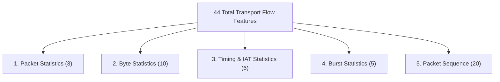

# Feature Engineering: 44-Dimensional Transport Flow Representation

This document provides a formal specification of the feature extraction pipeline implemented in `src/extract_features.py` and used by the classifier models in `src/encdns/analysis/fingerprinting.py`.

---

## 1. Zero Label Leakage Guarantee

To evaluate genuine side-channel metadata leakage without trivial shortcuts, the feature extraction engine enforces a strict zero-label-leakage policy:

1. **Excluded Transport Identifiers:** IP addresses, TCP/UDP port numbers, MAC addresses, TLS Server Name Indication (SNI), and HTTP/2 / HTTP/3 header values are **never passed to the feature extractor or model**.
2. **Direction Computation Only:** IP addresses are inspected exclusively in memory to map packets to directional signs ($+1$ for client $\rightarrow$ resolver, $-1$ for resolver $\rightarrow$ client), after which the IP strings are immediately discarded.
3. **Physical Flow Silhouettes:** The classifier learns strictly from physical packet sizes, packet counts, cumulative byte volumes, directional burst boundaries, and inter-packet arrival times.

---

## 2. Feature Taxonomies & Groupings

The feature space consists of exactly **44 numerical features** partitioned into five structural groups:

---

## 3. Detailed Feature Specifications

### Group 1: Packet Statistics (3 features)

Measures raw flow cardinality by direction.

| Feature Name | Type | Physical Units | Mathematical Definition / Calculation |
| :--- | :--- | :--- | :--- |
| `n_pkts` | Integer | Packets | Total packet count in the query transaction ($N_{\text{up}} + N_{\text{down}}$). |
| `n_up` | Integer | Packets | Count of packets sent from client to resolver ($\text{direction} = +1$). |
| `n_down` | Integer | Packets | Count of packets sent from resolver to client ($\text{direction} = -1$). |

---

### Group 2: Byte Volume & Directional Statistics (10 features)

Captures cumulative payload sizes and directional volume distributions.

| Feature Name | Type | Physical Units | Mathematical Definition / Calculation |
| :--- | :--- | :--- | :--- |
| `bytes_up` | Integer | Bytes | Sum of frame lengths of all upstream packets ($\sum s_{\text{up}}$). |
| `bytes_down` | Integer | Bytes | Sum of frame lengths of all downstream packets ($\sum s_{\text{down}}$). |
| `bytes_total` | Integer | Bytes | Total byte volume of the flow ($\text{bytes}_{\text{up}} + \text{bytes}_{\text{down}}$). |
| `ratio_bytes_down_up` | Float | Unitless ratio | $\text{bytes}_{\text{down}} / \text{bytes}_{\text{up}}$ (rounded to 4 decimal places; 0.0 if $\text{bytes}_{\text{up}} = 0$). |
| `up_mean` | Float | Bytes | Mean frame length of upstream packets. |
| `up_std` | Float | Bytes | Population standard deviation of upstream packet sizes. |
| `up_max` | Integer | Bytes | Maximum upstream packet size observed in the flow. |
| `down_mean` | Float | Bytes | Mean frame length of downstream packets. |
| `down_std` | Float | Bytes | Population standard deviation of downstream packet sizes. |
| `down_max` | Integer | Bytes | Maximum downstream packet size observed in the flow. |

---

### Group 3: Inter-Arrival Times (IAT) & Flow Timing (6 features)

Measures network transmission latency and inter-packet intervals.

| Feature Name | Type | Physical Units | Mathematical Definition / Calculation |
| :--- | :--- | :--- | :--- |
| `duration` | Float | Seconds | Total flow duration: $t_{\text{last}} - t_{\text{first}}$ (rounded to 6 decimal places). |
| `iat_mean` | Float | Seconds | Arithmetic mean of inter-arrival times: $\frac{1}{N-1} \sum_{i=1}^{N-1} (t_{i+1} - t_i)$. |
| `iat_std` | Float | Seconds | Population standard deviation of inter-arrival times. |
| `iat_median` | Float | Seconds | Median inter-arrival time (0.0 if $N \le 1$). |
| `iat_max` | Float | Seconds | Maximum inter-packet arrival time observed. |
| `t_first_down` | Float | Seconds | Timestamp of the first downstream packet relative to flow start ($t_0$). |

---

### Group 4: Directional Burst Statistics (5 features)

A *burst* is defined as an unbroken sequence of consecutive packets transmitted in the same direction. When the transmission direction changes, the current burst terminates and a new burst begins.

| Feature Name | Type | Physical Units | Mathematical Definition / Calculation |
| :--- | :--- | :--- | :--- |
| `n_bursts` | Integer | Count | Total number of directional runs / transitions in the flow. |
| `burst_len_mean` | Float | Packets | Mean number of packets per burst ($\frac{1}{B} \sum_{b=1}^B L_b$). |
| `burst_len_max` | Integer | Packets | Maximum packet count observed in any single burst ($\max L_b$). |
| `burst_bytes_mean`| Float | Bytes | Mean byte volume per burst ($\frac{1}{B} \sum_{b=1}^B V_b$). |
| `burst_bytes_max` | Integer | Bytes | Maximum byte volume observed in any single burst ($\max V_b$). |

---

### Group 5: Signed Packet Sequences (20 features)

Preserves the chronological shape of early connection setup, TLS/QUIC handshakes, and initial DNS answer frames.

| Feature Name | Type | Physical Units | Mathematical Definition / Calculation |
| :--- | :--- | :--- | :--- |
| `pkt_00` $\dots$ `pkt_19` | Integer | Signed Bytes | Signed frame length of the $i$-th packet: $+s_i$ if client $\rightarrow$ resolver, $-s_i$ if resolver $\rightarrow$ client. |

#### Zero-Padding and Sequence Truncation

* **Truncation:** Only the first 20 packets ($i = 0 \dots 19$) are recorded in sequence.
* **Zero-Padding:** If an encrypted DNS flow terminates in fewer than 20 packets (e.g., a fast 15-packet transaction), all remaining positions $pkt_k$ ($k \ge N$) are padded with `0`.

---

## 4. Missing Values & Preprocessing

* **Empty pcaps / $<3$ packets:** PCAPs with fewer than 3 packets are rejected during extraction (`too_few_packets`) to prevent corrupt or degenerate flow vectors.
* **No downstream response:** PCAPs lacking resolver responses are rejected (`server_packets_missing`).
* **Zero standard deviations:** If a flow has only 1 packet in a direction, the corresponding standard deviation (`up_std` or `down_std`) evaluates to `0.0`.
* **Zero division safety:** If `bytes_up == 0`, `ratio_bytes_down_up` evaluates safely to `0.0`.
