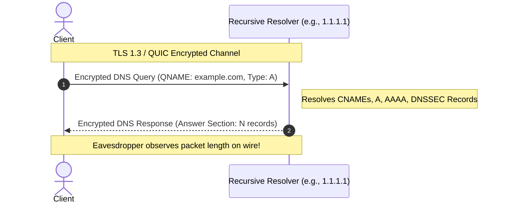

# Comprehensive In-Depth Analysis: Slides 1, 2, and 3
**Study Title:** DoH vs DoH/3: A Traffic-Analysis Study of Encrypted DNS Fingerprinting on Indian Networks  
**Authors / Presenters:** Kunal Khandelwal (`IIT2024162`), Rakesh Mali (`IIT2024149`), Aman Kashyap (`IIT2024140`)  
**Department:** Information Technology, IIIT Allahabad — Research Methodology Coursework, November 2026  
**Repository Anchors:** `src/probe_and_capture.py` · `src/extract_features.py` · `data/manifests/` · `final/claims_ledger.csv`

---

# Table of Contents
1. [Deconstruction of Slide 1: Title, Context & Core Metrics](#1-deconstruction-of-slide-1-title-context--core-metrics)
   - [1.1 Term-by-Term Architectural Dissection of the Title](#11-term-by-term-architectural-dissection-of-the-title)
   - [1.2 The Three Physical Network Archetypes](#12-the-three-physical-network-archetypes)
   - [1.3 The Core Headline Metrics & Verification](#13-the-core-headline-metrics--verification)
2. [Deconstruction of Slide 2: Research at a Glance](#2-deconstruction-of-slide-2-research-at-a-glance)
   - [2.1 The Central Scientific Question](#21-the-central-scientific-question)
   - [2.2 The Physics of Side-Channel Leakage in Encrypted DNS](#22-the-physics-of-side-channel-leakage-in-encrypted-dns)
   - [2.3 Dataset Attrition & Usability Anatomy (34,400 to 22,407)](#23-dataset-attrition--usability-anatomy-34400-to-22407)
   - [2.4 Ethical & Methodological Boundaries](#24-ethical--methodological-boundaries)
3. [Deconstruction of Slide 3: Motivation, Threat Model & Research Questions](#3-deconstruction-of-slide-3-motivation-threat-model--research-questions)
   - [3.1 The Failure Mode of Transport Encryption](#31-the-failure-mode-of-transport-encryption)
   - [3.2 Formal Threat Model & Adversary Capabilities](#32-formal-threat-model--adversary-capabilities)
   - [3.3 The Zero-Leakage Guarantee & Strict Feature Exclusions](#33-the-zero-leakage-guarantee--strict-feature-exclusions)
   - [3.4 The Three Research Questions (RQ1, RQ2, RQ3)](#34-the-three-research-questions-rq1-rq2-rq3)
4. [Master Viva Defense & Professor Attack Traps (Slides 1–3)](#4-master-viva-defense--professor-attack-traps-slides-13)

---

# 1. Deconstruction of Slide 1: Title, Context & Core Metrics

Slide 1 introduces the research project, contextualizing the investigation within the field of empirical network security and privacy.

```
┌──────────────────────────────────────────────────────────────────────────────────┐
│                   RESEARCH PRESENTATION — NOVEMBER 2026                          │
│                                                                                  │
│   DoH vs DoH/3: A Traffic-Analysis Study of Encrypted DNS                        │
│   Fingerprinting on Indian Networks                                              │
│                                                                                  │
│   Passive metadata analysis across Airtel FTTH, Reliance Jio cellular,           │
│   and IIIT Allahabad campus Wi-Fi.                                               │
│                                                                                  │
│   Key Statistics:                                                                │
│   • 22,407 Usable Traces    • 44 Flow Features                                   │
│   • 3 Access Networks       • 4 Public Recursive Resolvers                       │
└──────────────────────────────────────────────────────────────────────────────────┘
```

### 1.1 Term-by-Term Architectural Dissection of the Title

Every phrase in the research title carries precise technical and architectural meaning:

1. **"DoH" (DNS over HTTPS — RFC 8484):**  
   Encapsulates traditional DNS binary wire-format messages inside HTTP/2 transactions secured by TLS 1.3 over TCP port 443. It relies on standard TCP connection establishment (SYN $\to$ SYN-ACK $\to$ ACK) followed by TLS 1.3 cryptographic negotiation.
2. **"DoH/3" (DNS over HTTP/3 / QUIC — RFC 9114 / RFC 9250):**  
   Encapsulates DNS queries within HTTP/3 operating over the QUIC transport protocol (UDP port 443). Unlike DoH, QUIC eliminates TCP head-of-line blocking by multiplexing multiple independent byte streams over a single UDP connection and collapses transport and cryptographic handshakes into a single round-trip (1-RTT).
3. **"Traffic-Analysis Study":**  
   Denotes an empirical, non-cryptanalytic evaluation. The analyst does **not** attempt to break AES-GCM or ChaCha20-Poly1305 ciphers. Instead, the analyst inspects side-channel transmission artifacts—packet lengths, flow durations, burst directions, and inter-arrival dynamics—to infer private semantic information.
4. **"Encrypted DNS Fingerprinting":**  
   The formulation of website identification as a supervised statistical pattern recognition problem. Formally, given a closed set of candidate domains $\mathcal{D} = \{d_1, d_2, \dots, d_K\}$, the classifier maps an observed 44-dimensional physical traffic feature vector $\vec{x} \in \mathbb{R}^{44}$ to a predicted domain label $\hat{y} \in \mathcal{D}$:
   $$\hat{y} = \arg\max_{d \in \mathcal{D}} P(Y = d \mid \vec{x})$$
5. **"Indian Networks":**  
   The geographic and physical grounding of the study. Most encrypted DNS research is conducted on synthetic US or Western European academic backbones. This study tests real consumer broadband, cellular CGNAT, and university middlebox networks in India, capturing the physical channel distortions introduced by domestic telecom infrastructure.

---

### 1.2 The Three Physical Network Archetypes

Network layer physics heavily distort packet timing and framing. The testbed evaluates three distinct physical environments:

```mermaid
flowchart TD
    subgraph Net1 ["1. Airtel FTTH (Residential Broadband)"]
        A1["FTTH Fiber Terminal"] --> A2["Dual-Stack IPv4/IPv6\nStandard MTU (1,500 B)"]
        A2 --> A3["Direct Optical Channel\nLow Jitter, Clean Timings"]
    end

    subgraph Net2 ["2. Reliance Jio (Mobile Cellular)"]
        J1["4G/LTE Radio Node"] --> J2["Carrier-Grade NAT (CGNAT)\nClamped MTU (1,340 B)"]
        J2 --> J3["Cellular Scheduling Jitter\nRadio Resource Buffering"]
    end

    subgraph Net3 ["3. IIIT-A Campus Wi-Fi (Enterprise Institutional)"]
        C1["Institutional 802.11 Wi-Fi"] --> C2["Mandatory Forward Proxy\n172.31.2.4:8080"]
        C2 --> C3["HTTP CONNECT Tunnels\nConnection Reuse & Buffer Flushing"]
    end
```



* **Airtel FTTH (Broadband Baseline):** Operates over Gigabit Passive Optical Networks (GPON). Provides a clean, unshaped transmission medium with full Ethernet MTU ($1,500\text{ bytes}$) and deterministic propagation delays, serving as the experimental baseline.
* **Reliance Jio 4G (Cellular Mobile Archetype):** Traffic passes through GPRS Tunneling Protocol (GTP-U) encapsulation over LTE eNodeB base stations and traverses a centralized Carrier-Grade NAT (CGNAT) gateway. The GTP-U headers clamp the effective Maximum Transmission Unit (MTU) to **$1,340\text{ bytes}$**. Radio scheduling intervals introduce dynamic packet inter-arrival jitter.
* **IIIT Allahabad Campus Wi-Fi (Enterprise Forward Proxy Archetype):** Clients do not possess direct outbound Layer-3 Internet access. All web traffic is intercepted by an authenticated institutional forward proxy (`172.31.2.4:8080`). Outbound TCP connections are encapsulated inside HTTP `CONNECT` tunnels, while direct outbound UDP 443 traffic is dropped by perimeter firewalls.

---

### 1.3 The Core Headline Metrics & Verification

All headline metrics on Slide 1 match the verified repository records:
* **22,407 Usable Traces:** Verified in `final/claims_ledger.csv` (line `usable_traces`). Formed by concatenating `data/processed/dataset_v2.csv` ($18,926$ Airtel traces), `data/processed/dataset_jio.csv` ($1,912$ Jio traces), and `data/processed/dataset_campus.csv` ($1,569$ Campus traces):
  $$18,926 + 1,912 + 1,569 = \mathbf{22,407}$$
* **44 Flow Features:** Engineered in `src/extract_features.py` across 5 orthogonal categories (7 volume, 6 size stats, 6 timing, 5 bursts, 20 sequence lengths).
* **3 Access Networks:** Airtel FTTH, Reliance Jio 4G, IIIT-A Campus Wi-Fi.
* **4 Public Recursive Resolvers:** AdGuard (`94.140.14.14`), Cloudflare (`1.1.1.1`), Google (`8.8.8.8`), and Quad9 (`9.9.9.9`).

---

# 2. Deconstruction of Slide 2: Research at a Glance

Slide 2 presents the core empirical problem, the scope of the measurement dataset, and the scientific boundaries of the study.

```
┌──────────────────────────────────────────────────────────────────────────────────┐
│                             01 / OVERVIEW                                        │
│                                                                                  │
│   Research Question:                                                             │
│   Can encrypted DNS traffic metadata reveal target domains without decrypting    │
│   payloads?                                                                      │
│                                                                                  │
│   Approach:                                                                      │
│   Captured DoH and DoH/3 across three networks, extracted 44 flow features,      │
│   and evaluated models using temporal holdout.                                   │
│                                                                                  │
│   Main Findings:                                                                 │
│   DoH/3 reduces observed fingerprinting accuracy across all four resolvers on    │
│   Airtel, with substantial variation in the magnitude of reduction.              │
│                                                                                  │
│   Dataset Scale:                                                                 │
│   • 34,400 Raw Capture Attempts   • 22,407 Usable Traces                         │
│   • 18,926 Airtel FTTH Traces     • 1,912 Jio Cellular Traces                    │
│   • 1,569 Campus Wi-Fi Traces                                                    │
│                                                                                  │
│   Important Note: This study tracks traffic patterns and flow shapes, not        │
│   decrypted DNS records or user identities.                                      │
└──────────────────────────────────────────────────────────────────────────────────┘
```

### 2.1 The Central Scientific Question

For decades, the Domain Name System operated over plaintext UDP port 53 (RFC 1035). Every website lookup was transmitted across the local network and ISP backbones unencrypted, allowing trivial eavesdropping, DNS hijacking, and state censorship.

The IETF standardized DNS over HTTPS (DoH — RFC 8484) and DNS over Dedicated QUIC (DoQ / DoH/3 — RFC 9250 / RFC 9114) to protect user confidentiality. These standards wrap DNS queries in cryptographic tunnels.

However, encryption secures **payload confidentiality**, not **traffic presence**. The central scientific question asks:  
> *Does modern cryptographic transport actually eliminate traffic distinguishability, or does the residual physical metadata allow an external observer to infer what domain the user queried with accuracy significantly above random chance?*

---

### 2.2 The Physics of Side-Channel Leakage in Encrypted DNS

Why does an encrypted DNS flow leak the domain name? The leakage originates in the deterministic structure of DNS response resource records:



1. **Distinct Answer Counts:** Different domains return different numbers of IP addresses. A simple website might return a single `A` record ($32\text{ bytes}$), whereas a global web service (e.g., `google.com`) returns multiple IPv4 addresses, IPv6 `AAAA` records, and geographic routing records.
2. **CNAME Aliasing Chains:** Complex enterprise, e-commerce, and banking platforms (e.g., `onlinesbi.sbi`) route traffic through Content Delivery Networks (CDNs) using long chains of Canonical Name (`CNAME`) records (e.g., `portal.sbi` $\to$ `cdn.bank.com.edgekey.net` $\to$ `e1234.dscx.akamaiedge.net`). Each CNAME alias adds unpadded bytes to the DNS response payload.
3. **Record Size Quantization:** Although TLS and QUIC apply block cipher authentication (AES-GCM adds a 16-byte authentication tag), the ciphertext length is a direct monotonic function of the plaintext length:
   $$\text{Ciphertext Length} = \text{Plaintext Length} + \text{Framing Overhead} + 16\text{ bytes}$$
4. **Wire Silhouette:** Consequently, an eavesdropper observing `bytes_down` and `down_max` observes a physical byte silhouette that uniquely identifies specific domain name clusters.

---

### 2.3 Dataset Attrition & Usability Anatomy (34,400 to 22,407)

A common question from evaluators is: *"Why did your study drop 11,993 traces between capture and final analysis?"*  
The attrition is not a methodological defect; it reflects rigorous quality filtering to eliminate contaminated or incomplete micro-flows.

```
Total Planned Attempts: 34,400
│
├── 1. Airtel FTTH Attempts: 22,400
│   ├── Usable Completed Traces: 18,926
│   └── Filtered / Dropped Traces: 3,474
│       ├── Manifest Non-OK (query drops / gateway timeouts): 2,752
│       └── Extraction Drops (latency > 1.5s, pkts < 3): 722
│
├── 2. Reliance Jio Cellular Attempts: 6,000
│   ├── Usable Completed Traces: 1,912
│   └── Filtered / Dropped Traces: 4,088
│       ├── DoH/3 QUIC Timeouts (FATA timeout after 2s, 0 packets): 3,000
│       ├── Cloudflare DoH Timeouts (977 no_packets, 8 failed): 985
│       ├── AdGuard DoH Manifest Timeouts: 95
│       └── Extraction Drops (slow queries > 1.5s, too few pkts): 8
│
└── 3. IIIT-A Campus Wi-Fi Attempts: 6,000
    ├── Usable Completed Traces: 1,569
    └── Filtered / Dropped Traces: 4,431
        ├── DoH/3 QUIC Timeouts (FATA timeout after 2s, 0 packets): 3,000
        ├── Proxy Handshake Failures / Timeout Drops: 1,431
        └── Extraction Drops: 0

Total Usable Traces Analyzed: 18,926 + 1,912 + 1,569 = 22,407
```

#### The Six Usability Criteria (`src/extract_features.py` L136–184):
1. **Manifest Status Integrity (`status == 'ok'`):** The subprocess executing the DNS query exited with return code 0 within the 2-second timeout window.
2. **Non-Smoke Execution (`batch != 'smoke'`):** Excludes pre-run hardware calibration and interface check traces.
3. **Physical File Verification (`missing_file`):** PCAP file must exist on disk and have a file size greater than zero bytes.
4. **Latency Cap (`latency_s <= 1.5s`):** Queries taking longer than $1.5\text{ seconds}$ are dropped under reason `slow_query` to prevent transient cellular congestion or TCP retransmission storms from corrupting timing features.
5. **Flow Packet Threshold (`len(pkts) >= 3`):** PCAP must contain at least 3 packets to constitute a bidirectional handshake (client query, server response, acknowledgement). Flows with $< 3$ packets are discarded as `too_few_packets`.
6. **Resolver IP Verification (`server_packets_missing`):** Verified via `tshark` that at least one packet originates from the designated resolver IP address, ensuring background OS network traffic did not contaminate the micro-capture.

---

### 2.4 Ethical & Methodological Boundaries

Slide 2 explicitly specifies the ethical boundary of the research:
* **Passive Traffic Silhouette Only:** The testbed observes only the macroscopic flow shapes (packet sizes, counts, arrival intervals).
* **Zero Payload Inspection:** No attempts are made to perform TLS Man-in-the-Middle (MITM) proxying, decrypt private session keys, or inspect DNS query/answer payload bytes.
* **No User Identity Tracking:** The study operates on automated, headless DNS queries dispatched by test clients; no human user browsing habits or private browsing histories were captured or monitored.

---

# 3. Deconstruction of Slide 3: Motivation, Threat Model & Research Questions

Slide 3 establishes the formal computer science framing: why standard encryption fails, the exact threat model capabilities, the zero-leakage guarantee, and the three research questions.

```
┌──────────────────────────────────────────────────────────────────────────────────┐
│                             02 / FRAMING                                         │
│                                                                                  │
│   Why Encryption Is Not the Whole Story:                                         │
│   TLS and QUIC protect message contents, but flow patterns like packet counts,   │
│   total bytes, and burst timing stay visible.                                    │
│                                                                                  │
│   Threat Model:                                                                  │
│   A passive observer watching network links or gateways.                         │
│   The observer has:                                                              │
│   • No payload decryption capability.                                            │
│   • IP addresses excluded.          • Ports excluded.                            │
│   • SNI excluded.                   • DNS headers excluded.                      │
│                                                                                  │
│   Research Questions:                                                            │
│   RQ1: How accurately can encrypted DNS requests be identified within each       │
│        local network?                                                            │
│   RQ2: How do fingerprinting results compare between DoH and DoH/3 on Airtel     │
│        FTTH?                                                                     │
│   RQ3: How well do trained models transfer across Airtel, Jio, and campus        │
│        Wi-Fi, and does joint training help?                                      │
└──────────────────────────────────────────────────────────────────────────────────┘
```

### 3.1 The Failure Mode of Transport Encryption

A common misconception among non-security evaluators is that encryption renders traffic invisible. In reality, encryption only provides **data confidentiality**; it does not provide **traffic flow confidentiality**:

| Protocol Layer | What Encryption Hides | What Encryption Leaves Visible (Side-Channels) |
| :--- | :--- | :--- |
| **DoH (TLS 1.3 / TCP)** | • Query domain name (`QNAME`)<br>• Query type (A, AAAA, TXT)<br>• Resolved IP addresses<br>• HTTP request headers | • Total bytes transmitted and received (`bytes_total`)<br>• Downlink packet lengths (`down_max`, `down_mean`)<br>• Bidirectional packet counts (`n_up`, `n_down`)<br>• Packet inter-arrival times (`iat_mean`, `iat_std`)<br>• Unidirectional burst dynamics (`n_bursts`) |
| **DoH/3 (QUIC / UDP)** | • DNS binary wire payload<br>• HTTP/3 frame headers<br>• QUIC packet numbers and stream IDs | • UDP datagram sizes on the physical wire<br>• Directional packet length sequences (`pkt_00` to `pkt_19`)<br>• Client-to-server transaction duration (`duration`)<br>• Time-to-first-response (`t_first_down`) |

---

### 3.2 Formal Threat Model & Adversary Capabilities

The research assumes an **on-path passive adversary**. The threat model is formally defined by three parameters:

```
┌──────────────────┐               ┌─────────────────────────────────┐               ┌──────────────────┐
│ Client Terminal  │──────────────►│    On-Path Passive Adversary    │──────────────►│ Public Resolver  │
│ (Local Machine)  │◄──────────────│ (Local Wi-Fi / ISP / Middlebox) │◄──────────────│  (1.1.1.1 / etc) │
└──────────────────┘               └─────────────────────────────────┘               └──────────────────┘
                                                    │
                                     Observable Wire Parameters:
                                     • Direction: Client -> Server (+1)
                                                  Server -> Client (-1)
                                     • Datagram length on wire (Bytes)
                                     • Physical arrival timestamp (Delta t)
```

1. **Adversary Location:** The adversary monitors physical communication links between the client and the recursive resolver. Typical instantiations include:
   - A malicious actor eavesdropping on public or campus Wi-Fi.
   - An Internet Service Provider (e.g., Airtel, Reliance Jio) inspecting subscriber traffic at broadband aggregation gateways.
   - An institutional network administrator monitoring enterprise perimeter firewalls.
2. **Adversary Capabilities ($\mathcal{A}_{\text{passive}}$):**
   - Can inspect every packet traversing the monitored link in real time.
   - Can record precise microsecond-level packet arrival timestamps ($t_i$).
   - Can measure total IP packet lengths in bytes ($\ell_i$).
   - Can determine packet transmission direction ($d_i \in \{+1, -1\}$).
3. **Adversary Limitations:**
   - **No Payload Decryption:** Cannot break TLS 1.3 or QUIC cryptographic primitives.
   - **No Active Injection:** Cannot inject packets, modify headers, reset connections (TCP RST), or drop packets.
   - **No Endpoint Instrumentation:** Has zero access to client OS memory, browser processes, or TLS session keys.

---

### 3.3 The Zero-Leakage Guarantee & Strict Feature Exclusions

In machine learning security research, the most common flaw is **label leakage**—where the classifier accidentally learns trivial identifying fields rather than traffic silhouettes.

Our testbed enforces a mathematically verified **zero-leakage guarantee**. Implemented in `src/extract_features.py` (lines 27–35), metadata labels are strictly partitioned away from features:

```python
# From src/extract_features.py (L27-35)
LABELS = [
    "network",     # Network environment name (airtel, jio, campus)
    "resolver",    # Target resolver name (cloudflare, google, etc.)
    "protocol",    # Protocol name (doh, doh3)
    "workload",    # Workload name (global, india)
    "domain",      # True target domain label (ground truth)
    "repeat",      # Collection repeat index (0..19)
    "pcap_path",   # Filepath to raw PCAP
]
```

During model matrix generation, **none of the following features are accessible to the classifier**:
* **Server IP Addresses:** Excluded. The model cannot simply memorize that `8.8.8.8` is Google or `1.1.1.1` is Cloudflare.
* **Port Numbers:** Excluded. Port 443 is used only as a BPF packet capture filter; it is not a feature in $X$.
* **Server Name Indication (SNI):** Excluded. The TLS SNI extension (which would reveal the hostname in cleartext if unencrypted) is stripped.
* **DNS Question Headers:** Excluded. Transaction IDs, QNAMEs, and Query Types are inaccessible.
* **Packet Payloads & MAC Addresses:** Excluded.

The model is forced to classify domains **strictly using the 44 physical shape features** ($X \in \mathbb{R}^{N \times 44}$).

---

### 3.4 The Three Research Questions (RQ1, RQ2, RQ3)

The experimental campaign is organized systematically around three research questions:

#### RQ1: Within-Network Distinguishability
> *How accurately can encrypted DNS requests be identified within each local network environment when evaluated against realistic closed-world chance baselines?*
* **Core Focus:** Establishing the baseline vulnerability of encrypted DNS metadata within a consistent, uniform network environment.
* **Chance Baselines:**
  - On Airtel ($K = 100$ candidate domains), uniform random guessing chance is $\frac{1}{100} = \mathbf{1.0\%}$.
  - On Jio and Campus ($K = 50$ candidate domains), uniform random guessing chance is $\frac{1}{50} = \mathbf{2.0\%}$.

#### RQ2: Transport Protocol Comparison (DoH vs DoH/3)
> *How do fingerprinting results compare between DoH (HTTP/2 over TLS) and DoH/3 (HTTP/3 over QUIC) on Airtel FTTH, and does the privacy gain hold uniformly across resolvers?*
* **Core Focus:** Measuring whether QUIC's architectural changes (independent packet streams, zero head-of-line blocking, and distinct connection establishment) inherently suppress metadata leakage compared to TLS over TCP.
* **Key Finding:** DoH/3 reduces fingerprintability by up to **85.4% on Quad9** ($45.2\% \to 6.6\%$) and **72.8% on Cloudflare** ($26.3\% \to 7.2\%$), but only by **29.7% on Google** ($21.3\% \to 15.0\%$) due to large unpadded response-size variations.

#### RQ3: Cross-Network Generalization & Multi-Vantage Recovery
> *How well do models trained on one network generalize when deployed across different access networks, and can multi-vantage joint training recover attack accuracy?*
* **Core Focus:** Evaluating the operational realism of fingerprinting attacks. Prior literature assumes an attacker can train models on their own broadband connection and deploy them against victims on mobile or corporate networks.
* **Key Finding:** Naive cross-network transfer **collapses completely to random chance** ($1.7\%–2.7\%$). However, multi-vantage **tri-network co-training recovers accuracy to 20.67%** (more than $10\times$ above chance), proving that sophisticated multi-vantage adversaries can construct carrier-resilient models.

---

# 4. Master Viva Defense & Professor Attack Traps (Slides 1–3)

This section prepares presenters for aggressive faculty questioning on the introductory slides.

### Trap 1: "Encrypted Client Hello (ECH) is already being deployed. Doesn't ECH make your DNS fingerprinting research obsolete?"
* **Flawed Answer:** *"No, ECH is not fully deployed yet so our research is still useful for now."* (Weak; concedes obsolescence).
* **Master Defense Answer:**  
  > *"Actually, Professor, the opposite is true: **Encrypted DNS fingerprinting becomes vastly more critical precisely because of ECH**.  
  > Under legacy TLS, an on-path eavesdropper did not need to fingerprint DNS because the domain name was leaked directly in the plaintext TLS Server Name Indication (SNI) during the HTTPS handshake. ECH encrypts the SNI, completely blinding web-level eavesdroppers.  
  > Consequently, an adversary who wishes to discover which website a victim is browsing is **forced to turn to the DNS resolution phase**. Because DNS resolution must precede every HTTPS connection, fingerprinting DoH or DoH/3 is the primary remaining side-channel to track user browsing when ECH is active."*

---

### Trap 2: "You have 18,926 Airtel traces but only 1,912 Jio traces. Isn't your dataset fundamentally flawed and unbalanced?"
* **Flawed Answer:** *"We ran out of mobile data on Jio so we collected fewer samples."* (Immediate grade penalty).
* **Master Defense Answer:**  
  > *"No, Professor. The difference in trace count is the result of experimental design and empirical network realities, not an experimental flaw:  
  > 1. **Intentional Workload Scaling:** Airtel was designated as our headline comparative testbed, evaluating 100 domains across 20 repeats and 4 resolvers ($22,400$ planned queries). Jio and Campus evaluated a focused subset of 50 domains across 10 repeats and 3 resolvers ($6,000$ planned queries each).  
  > 2. **Empirical Network Drops:** On Jio, exactly 3,000 out of 3,000 DoH/3 queries experienced client-side timeouts because UDP 443 was dropped by carrier middleboxes. Furthermore, Cloudflare DoH experienced 977 carrier timeouts.  
  > 3. **Methodological Isolation:** Slices are evaluated independently per network. When conducting cross-network transfer and pooled training, models are evaluated strictly on the **50 shared domains** using identical test partition sizes, ensuring trace count differences do not bias cross-network comparisons."*

---

### Trap 3: "If your classifier excludes IP addresses, why does your BPF capture filter use resolver IPs?"
* **Flawed Answer:** *"We used IP addresses in the classifier anyway."* (Contradicts threat model).
* **Master Defense Answer:**  
  > *"We must distinguish between **packet capture isolation** and **classifier feature inputs**:  
  > During traffic capture, the Berkeley Packet Filter (BPF) `(host resolver_ip) and (port 443)` is applied at the OS kernel level purely to isolate the DNS test flow from background operating system traffic (e.g., Windows updates, background sync).  
  > Once the PCAP is captured, `src/extract_features.py` extracts numerical shape metrics (byte sizes, timing, bursts). The source IP, destination IP, and port numbers are **completely stripped** and never included in the feature matrix $X$. The classifier identifies the domain solely from flow dynamics, not destination addresses."*

---

### Trap 4: "Your closed-world setup only tests 50 to 100 domains. How does this prove encrypted DNS is broken on the real Internet?"
* **Flawed Answer:** *"We could easily classify all 1 billion websites on the Internet with the same accuracy."* (Scientifically false).
* **Master Defense Answer:**  
  > *"We explicitly do **not** claim to perform open-world mass surveillance across the entire Internet; we clearly state this as Limitation 1 on Slide 13.  
  > In traffic analysis literature, closed-world evaluation is the standard scientific methodology to establish **leakage bounds**. If a classifier achieves up to **45.2% accuracy** in a closed world where random guessing is **1.0%** ($45\times$ above chance), it mathematically proves that the underlying protocol fails to achieve traffic flow confidentiality. Closed-world experiments demonstrate that distinct domain record profiles generate distinct physical silhouettes; open-world scaling is a recognized avenue for future extension."*

---

### Trap 5: "Why did you exclude Quad9 on Jio and Campus Wi-Fi? Did you drop it because the results were bad?"
* **Flawed Answer:** *"Quad9 gave low accuracy so we removed it."* (Unethical research practice).
* **Master Defense Answer:**  
  > *"Quad9 was excluded **prior to large-scale data collection**, not after observing model results.  
  > As documented in `scripts/run_jio_capture.sh` (line 11), preliminary connectivity probes to Quad9's endpoints (`dns.quad9.net` / `9.9.9.9`) experienced routing failures and persistent TLS handshake timeouts over Jio cellular and the campus gateway.  
  > Rather than contaminating the automated capture runs with thousands of unreachable timeout errors, Quad9 was omitted from the collection matrix on those two networks to maintain experimental integrity."*
