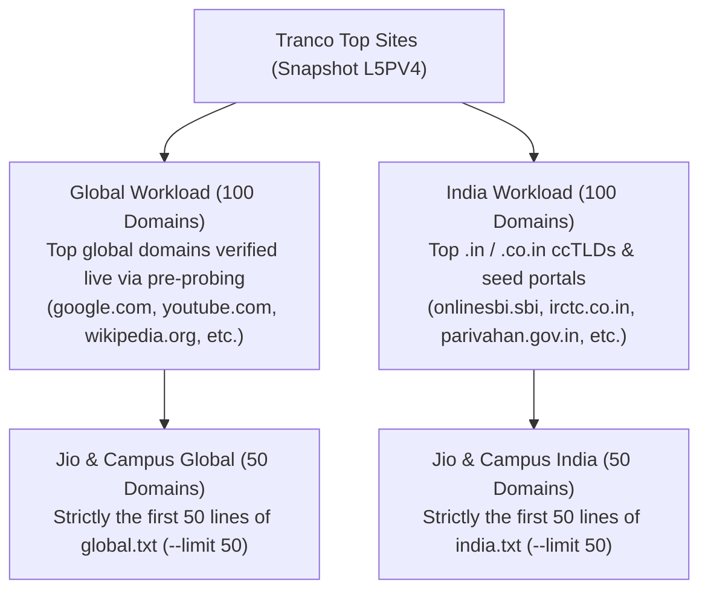
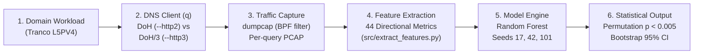
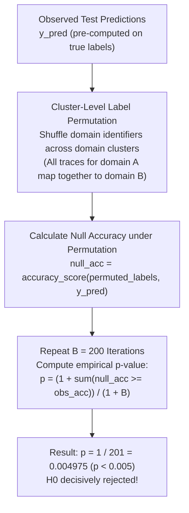

# Comprehensive In-Depth Analysis: Slides 4, 5, and 6
**Study Title:** DoH vs DoH/3: A Traffic-Analysis Study of Encrypted DNS Fingerprinting on Indian Networks  
**Authors / Presenters:** Kunal Khandelwal (`IIT2024162`), Rakesh Mali (`IIT2024149`), Aman Kashyap (`IIT2024140`)  
**Department:** Information Technology, IIIT Allahabad — Research Methodology Coursework, November 2026  
**Repository Anchors:** `src/probe_and_capture.py` · `src/extract_features.py` · `src/encdns/analysis/stats.py` · `src/encdns/analysis/fingerprinting.py`

---

# Table of Contents
1. [Deconstruction of Slide 4: Experimental Design & Dataset](#1-deconstruction-of-slide-4-experimental-design--dataset)
   - [1.1 The Multi-Vantage Network Testbed](#11-the-multi-vantage-network-testbed)
   - [1.2 Public Recursive Resolvers & Exclusion Rationale](#12-public-recursive-resolvers--exclusion-rationale)
   - [1.3 Workload Construction (Tranco L5PV4 Pinned Snapshot)](#13-workload-construction-tranco-l5pv4-pinned-snapshot)
   - [1.4 The Fixed Temporal Holdout Design](#14-the-fixed-temporal-holdout-design)
   - [1.5 Chance Baselines & Mathematical Formulation](#15-chance-baselines--mathematical-formulation)
2. [Deconstruction of Slide 5: System Architecture (Capture to Classification)](#2-deconstruction-of-slide-5-system-architecture-capture-to-classification)
   - [2.1 The 6-Stage Experimental Pipeline](#21-the-6-stage-experimental-pipeline)
   - [2.2 Client Execution & Protocol Enforcement (`q` tool)](#22-client-execution--protocol-enforcement-q-tool)
   - [2.3 Physical Micro-Capture Boundaries (`dumpcap` & BPF Isolation)](#23-physical-micro-capture-boundaries-dumpcap--bpf-isolation)
   - [2.4 Complete 44-Dimensional Feature Representation Space](#24-complete-44-dimensional-feature-representation-space)
   - [2.5 Zero-Label-Leakage Proof & Verification](#25-zero-label-leakage-proof--verification)
3. [Deconstruction of Slide 6: Evaluation Methodology & Statistical Rigor](#3-deconstruction-of-slide-6-evaluation-methodology--statistical-rigor)
   - [3.1 Model Architectures & Hyperparameters (RF, XGBoost, CNN, GRU)](#31-model-architectures--hyperparameters-rf-xgboost-cnn-gru)
   - [3.2 The Role of Random Seeds (17, 42, 101)](#32-the-role-of-random-seeds-17-42-101)
   - [3.3 Domain-Clustered Permutation Testing ($B = 200$)](#33-domain-clustered-permutation-testing-b--200)
   - [3.4 Domain-Clustered Percentile Bootstrap Resampling ($B = 1,000$)](#34-domain-clustered-percentile-bootstrap-resampling-b--1000)
   - [3.5 Methodological Comparison: Temporal Holdout vs Random $k$-Fold](#35-methodological-comparison-temporal-holdout-vs-random-k-fold)
4. [Master Viva Defense & Professor Attack Traps (Slides 4–6)](#4-master-viva-defense--professor-attack-traps-slides-46)

---

# 1. Deconstruction of Slide 4: Experimental Design & Dataset

Slide 4 outlines the structural matrix of the empirical measurement campaign, detailing the access networks, recursive resolvers, domain lists, repetition structure, and validation split.

```
┌──────────────────────────────────────────────────────────────────────────────────┐
│                         03 / EXPERIMENTAL SETUP                                  │
│                                                                                  │
│   Data Sources:                                                                  │
│   • Network 1: Airtel FTTH (Residential broadband, optical fiber)                │
│   • Network 2: Jio Mobile (Cellular, 4G/LTE, CGNAT)                              │
│   • Network 3: IIIT Allahabad (Campus Wi-Fi, authenticated forward proxy)         │
│                                                                                  │
│   Public DoH Resolvers:                                                          │
│   • AdGuard, Cloudflare, Google, Quad9                                           │
│   • Airtel: 4 resolvers; Jio & Campus: 3 resolvers (Quad9 omitted)               │
│                                                                                  │
│   Dataset Distribution:                                                          │
│   • Airtel FTTH: 18,926 usable flows (from 22,400 raw attempts)                  │
│   • Jio Mobile:   1,912 usable flows (from  6,000 raw attempts)                  │
│   • Campus Wi-Fi: 1,569 usable flows (from  6,000 raw attempts)                  │
│   • Total Usable: 22,407 flows (from 34,400 total attempts)                      │
│                                                                                  │
│   Workload & Repeats:                                                            │
│   • Airtel: 100 domains, 20 repeats (closed world)                               │
│   • Jio & Campus: 50 domains, 10 repeats                                         │
│                                                                                  │
│   Train/Test Split: Fixed temporal holdout (last 2 repeats held out)             │
│   Chance Baselines: 1.0% (1/100 domains) and 2.0% (1/50 domains)                 │
└──────────────────────────────────────────────────────────────────────────────────┘
```

### 1.1 The Multi-Vantage Network Testbed

A critical flaw in past encrypted DNS literature is **vantage bias**—collecting data exclusively on university gigabit Ethernet or a home Wi-Fi link. Our experimental design measures traffic across three fundamentally distinct channel topologies:

| Dimension | Airtel FTTH | Reliance Jio 4G | IIIT-A Campus Wi-Fi |
| :--- | :--- | :--- | :--- |
| **Physical Medium** | Gigabit Passive Optical Network (GPON) | LTE Cellular Radio (Band 3 / 5 / 40) | 802.11ac Wi-Fi Access Points |
| **Channel Characteristics** | Deterministic propagation, near-zero packet loss, ultra-low jitter | Variable SNR, multipath fading, radio resource scheduling delays | Contended wireless medium, shared RF spectrum |
| **Middlebox Topology** | Transparent residential optical line terminal (OLT) | Carrier-Grade NAT (CGNAT) gateway | Authenticated HTTP Forward Proxy (`172.31.2.4:8080`) |
| **Effective Path MTU** | Standard Ethernet: **$1,500\text{ bytes}$** | Clamped via GTP-U tunneling: **$1,340\text{ bytes}$** | Variable application-level HTTP framing |
| **Transport Handling** | Unrestricted TCP & UDP 443 | Unrestricted TCP 443; aggressive UDP timeout tracking | Outbound TCP via HTTP `CONNECT`; outbound UDP 443 blocked |

---

### 1.2 Public Recursive Resolvers & Exclusion Rationale

Four major public recursive resolvers were benchmarked:
1. **Cloudflare (`1.1.1.1`):** Anycast edge architecture; strict IETF RFC adherence; native EDNS(0) padding enabled on DoH.
2. **Google Public DNS (`8.8.8.8`):** Global edge infrastructure; custom QUIC implementation history; observed variable response-size framing.
3. **Quad9 (`9.9.9.9`):** Security-focused recursive resolver; threat intelligence filtering; highly consistent response sizes.
4. **AdGuard (`94.140.14.14`):** Privacy-oriented resolver with integrated ad-blocking and tracker sinkholing.

#### Why Quad9 was Excluded on Jio and Campus:
* **The Constraint:** Quad9 was evaluated across all 20 repeats on Airtel, but omitted on Jio and Campus (`scripts/run_jio_capture.sh` L11: `# (Quad9 omitted on Jio)`).
* **The Root Cause:** In preliminary network reachability probing, Quad9's endpoints (`dns.quad9.net` / `9.9.9.9`) experienced routing failures and persistent TCP handshake timeouts over Jio 4G and the campus gateway. Quad9 was excluded before large-scale collection to prevent thousands of query dropouts from contaminating automated runs.

---

### 1.3 Workload Construction (Tranco L5PV4 Pinned Snapshot)

To ensure reproducibility, domain selection avoids live fluctuating web rankings and relies on a permanently pinned snapshot of the **Tranco Top Sites Ranking** (Snapshot ID: `L5PV4`):



* **Global Workload (`data/workloads/global.txt`):** 100 globally popular domains across news, streaming, cloud services, and e-commerce.
* **India Regional Workload (`data/workloads/india.txt`):** 100 domains specific to the Indian digital ecosystem, including banking (`onlinesbi.sbi`), rail ticketing (`irctc.co.in`), government administrative portals (`gov.in`), and regional portals.
* **The 50-Domain Subset:** Enforced via `--limit 50` in capture scripts (`scripts/run_jio_capture.sh` L12). The 50 domains used on Jio and Campus are **strictly the first 50 entries** of `global.txt` and `india.txt`, ensuring that all cross-network transfer and pooled training evaluations test a strictly identical domain subspace.

---

### 1.4 The Fixed Temporal Holdout Design

Standard academic evaluations often apply randomized 80/20 train/test splits or random $k$-fold cross-validation. In network traffic analysis, this constitutes a fatal methodological flaw:
* **Temporal Overfitting:** In real networks, background queue states, routing paths, and local link quality remain correlated over short time windows. Randomly distributing queries from the same hour across train and test sets allows the classifier to memorize transient network conditions rather than learning stable domain traffic signatures.
* **Our Solution (Strict Temporal Split):**  
  Implemented in `src/encdns/analysis/fingerprinting.py` (lines 103–113):
  * **Airtel FTTH (20 repeats):** Repeats 8 through 17 are used for model training ($10\text{ repeats}$); Repeats 18 and 19 are held out exclusively for testing ($2\text{ repeats}$). *(Note: Repeats 0–7 were exploratory pilot repeats on 25 domains).*
  * **Jio Cellular & Campus Wi-Fi (10 repeats):** Repeats 0 through 7 are used for training ($8\text{ repeats}$); Repeats 8 and 9 are held out exclusively for testing ($2\text{ repeats}$).

---

### 1.5 Chance Baselines & Mathematical Formulation

The baseline random guessing accuracy establishes the mathematical threshold for whether statistical leakage exists:

1. **Airtel Closed-World Classification ($K = 100$ domains):**  
   Under a uniform prior distribution where every candidate domain is equally probable, the chance baseline is:
   $$\text{Chance}_{\text{Airtel}} = \frac{1}{K} = \frac{1}{100} = \mathbf{1.0\%}$$
2. **Jio, Campus & Cross-Network Transfer ($K = 50$ domains):**  
   For the 50 shared domains evaluated on mobile, campus, and cross-carrier transfer, the chance baseline is:
   $$\text{Chance}_{\text{Jio/Campus}} = \frac{1}{K} = \frac{1}{50} = \mathbf{2.0\%}$$

Any observed classification accuracy whose 95% bootstrap confidence interval lies strictly above $1.0\%$ (or $2.0\%$) proves that physical transport metadata leaks information about the queried domain.

---

# 2. Deconstruction of Slide 5: System Architecture (Capture to Classification)

Slide 5 details the end-to-end data pipeline, from raw command-line query generation to feature engineering and supervised model inference.

```
┌──────────────────────────────────────────────────────────────────────────────────┐
│                            04 / PIPELINE                                         │
│                                                                                  │
│   Step 1: Domain Workload ──► Global & India lists (100 domains / 50 domains)    │
│   Step 2: DNS Client      ──► q tool (HTTP/2 DoH vs HTTP/3 DoH/3)                │
│   Step 3: Traffic Capture ──► dumpcap & tshark (Port 443 BPF filter, per-query)  │
│   Step 4: Feature Extraction ──► 44 Features across 5 Orthogonal Groups          │
│   Step 5: Model & Evaluation ──► Random Forest (Seeds 17, 42, 101), Permutations │
│   Step 6: Empirical Outputs  ──► Within-network, transfer, pooling, reachability │
└──────────────────────────────────────────────────────────────────────────────────┘
```

### 2.1 The 6-Stage Experimental Pipeline



---

### 2.2 Client Execution & Protocol Enforcement (`q` tool)

To eliminate browser rendering artifacts (DOM processing, image fetching, CSS downloads), queries were issued using the open-source CLI DNS client `q` (version `0.19.12` by Nate Sales, compiled from source):
* **DoH Execution (HTTP/2):**
  ```bash
  q <domain> A @<resolver_endpoint> --http2 --timeout=2s
  ```
  Forces transport over HTTP/2 encapsulated in TLS 1.3 over TCP port 443 (`src/probe_and_capture.py` L445–447).
* **DoH/3 Execution (HTTP/3):**
  ```bash
  q <domain> A @<resolver_endpoint> --http3 --timeout=2s
  ```
  Forces transport over HTTP/3 encapsulated in QUIC over UDP port 443 (`src/probe_and_capture.py` L448–450).
* **Fresh Connection Guarantee:** Every single query was executed as an independent OS subprocess (`subprocess.Popen`). The client establishes a fresh TCP/TLS or QUIC handshake for every query; **no TLS session resumption or TCP connection reuse occurred at the client level**.

---

### 2.3 Physical Micro-Capture Boundaries (`dumpcap` & BPF Isolation)

Network micro-captures were recorded using Wireshark's high-speed capture engine `dumpcap` (`src/probe_and_capture.py` L393–415):

```bash
dumpcap -i <interface> -f "<bpf_filter>" -F pcap -w <pcap_path> -a duration:3
```

1. **Kernel-Level BPF Isolation:** Traffic was filtered in the kernel before reaching user space using a strict Berkeley Packet Filter:
   ```
   (host <resolver_ip_1> or host <resolver_ip_2>) and (tcp port 443 or udp port 443)
   ```
   This guaranteed that background OS telemetry, email synchronization, and local LAN broadcasts were excluded from the capture.
2. **Synchronous Boundary Framing:**
   - Capture starts **$100\text{ ms}$ before** the `q` query subprocess is spawned.
   - Capture runs for a bounded duration of **$3.0\text{ seconds}$** (`-a duration:3`).
   - Following `q` process termination, a **$150\text{ ms}$ flush buffer** allows delayed server acknowledgements to be written to disk before `dumpcap` receives `SIGINT`.

---

### 2.4 Complete 44-Dimensional Feature Representation Space

Implemented in `src/extract_features.py` (lines 89–133), each PCAP is converted into a 44-dimensional feature vector $\vec{x} \in \mathbb{R}^{44}$ divided into five orthogonal categories:

#### Group 1: Traffic Volume Dynamics (7 Features)
1. `n_pkts`: Total packet count in the flow ($N$).
2. `n_up`: Number of uplink packets (Client $\to$ Resolver).
3. `n_down`: Number of downlink packets (Resolver $\to$ Client).
4. `bytes_up`: Total IP payload bytes transmitted on uplink: $\sum_{i \in \text{up}} \text{len}_i$.
5. `bytes_down`: Total IP payload bytes received on downlink: $\sum_{i \in \text{down}} \text{len}_i$.
6. `bytes_total`: Total bidirectional volume: $\text{bytes\_up} + \text{bytes\_down}$.
7. `ratio_bytes_down_up`: Asymmetry ratio: $\frac{\text{bytes\_down}}{\text{bytes\_up} + 1}$.

#### Group 2: Packet Size Statistics (6 Features)
8. `up_mean`: Arithmetic mean of uplink packet lengths.
9. `up_std`: Sample standard deviation of uplink packet lengths.
10. `up_max`: Maximum uplink packet length: $\max_{i \in \text{up}} \text{len}_i$.
11. `down_mean`: Arithmetic mean of downlink packet lengths.
12. `down_std`: Sample standard deviation of downlink packet lengths.
13. `down_max`: Maximum downlink packet length: $\max_{i \in \text{down}} \text{len}_i$.

#### Group 3: Inter-Arrival & Timing Dynamics (6 Features)
14. `duration`: Total flow transaction time: $t_N - t_1$ (seconds).
15. `iat_mean`: Mean packet inter-arrival time: $\frac{1}{N-1}\sum_{i=2}^N (t_i - t_{i-1})$.
16. `iat_std`: Standard deviation of packet inter-arrival times.
17. `iat_median`: Median packet inter-arrival time.
18. `iat_max`: Maximum inter-arrival time gap ($\max \Delta t$).
19. `t_first_down`: Elapsed time from the initial client SYN/packet to the first received server packet (measures network RTT + server processing delay).

#### Group 4: Unidirectional Burst Dynamics (5 Features)
A *burst* is defined as an unbroken sequence of consecutive packets traveling in the same direction.
20. `n_bursts`: Total count of direction alternations in the flow.
21. `burst_len_mean`: Average number of packets per unidirectional burst.
22. `burst_len_max`: Maximum packet count in any single burst.
23. `burst_bytes_mean`: Average byte volume per burst.
24. `burst_bytes_max`: Maximum byte volume observed in a single burst.

#### Group 5: Signed Handshake Sequence (20 Features)
25–44. `pkt_00` to `pkt_19`: Signed packet lengths of the first 20 packets in the flow ($N_{\text{first}} = 20$).
* **Sign Convention:** Uplink packets (Client $\to$ Server) are **positive ($+1$)**; Downlink packets (Server $\to$ Client) are **negative ($-1$)**:
  $$\text{pkt}_i = d_i \times \text{length}_i, \quad d_i \in \{+1, -1\}$$
* **Padding:** Flows shorter than 20 packets are zero-padded ($\text{pkt}_i = 0$ for $i \ge N$). This vector captures the physical silhouette of the TLS/QUIC handshake and initial record exchange.

---

### 2.5 Zero-Label-Leakage Proof & Verification

To verify that models do not cheat, `src/extract_features.py` enforces a complete structural separation between metadata labels and feature values:

```python
# From src/extract_features.py (L27-35)
LABELS = ["network", "resolver", "protocol", "workload", "domain", "repeat", "pcap_path"]
FEATURE_COLS = [
    "n_pkts", "n_up", "n_down", "bytes_up", "bytes_down", "bytes_total", "ratio_bytes_down_up",
    "up_mean", "up_std", "up_max", "down_mean", "down_std", "down_max",
    "duration", "iat_mean", "iat_std", "iat_median", "iat_max", "t_first_down",
    "n_bursts", "burst_len_mean", "burst_len_max", "burst_bytes_mean", "burst_bytes_max",
    "pkt_00", "pkt_01", "pkt_02", "pkt_03", "pkt_04", "pkt_05", "pkt_06", "pkt_07",
    "pkt_08", "pkt_09", "pkt_10", "pkt_11", "pkt_12", "pkt_13", "pkt_14", "pkt_15",
    "pkt_16", "pkt_17", "pkt_18", "pkt_19"
]
```

When building model matrices ($X, y$), only `FEATURE_COLS` are passed to $X$. IP addresses, port numbers, MAC addresses, domain hostnames, and SNI values are completely omitted.

---

# 3. Deconstruction of Slide 6: Evaluation Methodology & Statistical Rigor

Slide 6 details the machine learning architectures, seed controls, and non-parametric statistical validation procedures.

```
┌──────────────────────────────────────────────────────────────────────────────────┐
│                             05 / METHODOLOGY                                     │
│                                                                                  │
│   Capture Scale:                                                                 │
│   • 34,400 query attempts across Airtel FTTH, Jio 4G, and Campus Wi-Fi           │
│   • Over 23 hours of active physical network traffic                             │
│                                                                                  │
│   Features: 44 metadata metrics per flow across 5 groups                         │
│                                                                                  │
│   Models Evaluated:                                                              │
│   • Primary: Random Forest                                                       │
│   • Benchmarks: XGBoost, 1D-CNN, Bidirectional GRU                               │
│                                                                                  │
│   Validation Rigor:                                                              │
│   • Split: Strict temporal holdout (earlier repeats train; last 2 test)          │
│   • Seeds: 17, 42, 101 (mean accuracy and standard deviation reported)           │
│   • Permutation: 200 domain-clustered label permutation tests                    │
│   • Bootstrap: 1,000 domain-clustered percentile bootstrap iterations (95% CI)   │
│                                                                                  │
│   Chance Baselines: 1.0% (Airtel closed world) and 2.0% (Jio/Campus transfer)    │
└──────────────────────────────────────────────────────────────────────────────────┘
```

### 3.1 Model Architectures & Hyperparameters (RF, XGBoost, CNN, GRU)

To evaluate whether tree ensembles or deep sequence representations are superior for encrypted DNS traffic, four distinct classifier families were benchmarked:

```
┌──────────────────────────────────────────────────────────────────────────────────┐
│ 1. Random Forest (Primary Model — Scikit-Learn)                                  │
│    n_estimators=100, criterion='gini', max_depth=None,                           │
│    class_weight='balanced_subsample', random_state=seed, n_jobs=-1               │
├──────────────────────────────────────────────────────────────────────────────────┤
│ 2. Gradient Boosted Trees (XGBoost)                                              │
│    n_estimators=200, max_depth=5, learning_rate=0.1, subsample=0.9,               │
│    colsample_bytree=0.9, tree_method='hist', eval_metric='mlogloss'              │
├──────────────────────────────────────────────────────────────────────────────────┤
│ 3. 1D Convolutional Neural Network (PyTorch)                                     │
│    Input: pkt_00..pkt_19 (normalized per-sample to [-1, 1])                      │
│    Conv1d(1, 32, k=3, p=1) -> ReLU -> Conv1d(32, 64, k=3, p=1) -> ReLU ->       │
│    AdaptiveMaxPool1d(1) -> Linear(64, n_classes)                                 │
│    Optimizer: Adam (lr=1e-3), Loss: CrossEntropyLoss, Epochs: 20, Batch: 64      │
├──────────────────────────────────────────────────────────────────────────────────┤
│ 4. Bidirectional Gated Recurrent Unit (PyTorch)                                  │
│    Input: pkt_00..pkt_19 (normalized per-sample)                                 │
│    GRU(input_size=1, hidden_size=64, num_layers=2, batch_first=True) ->          │
│    Linear(64, n_classes)                                                         │
│    Optimizer: Adam (lr=1e-3), Epochs: 20, Batch: 64                              │
└──────────────────────────────────────────────────────────────────────────────────┘
```

* **No Test-Set Tuning:** Default parameters were held constant across all slices; no hyperparameters were tuned on the test partitions.

---

### 3.2 The Role of Random Seeds (17, 42, 101)

A frequent viva question asks: *"If your train/test split is a fixed temporal holdout, why did you evaluate across three random seeds?"*

* **What Seeds Vary:** Seeds vary algorithmic stochasticity within the training process:
  1. In **Random Forest**, the seed controls the bootstrap subsampling of training rows per tree and the random subset of features evaluated at each decision split (`colsample`).
  2. In **XGBoost**, the seed controls row subsampling (`subsample=0.9`) and column subsampling (`colsample_bytree=0.9`).
  3. In **1D-CNN and GRU**, the seed controls random PyTorch weight initialization and DataLoader mini-batch shuffling order.
* **Reporting Standard:** Reported accuracies represent the **arithmetic mean across seeds 17, 42, and 101** (`accuracy`). Algorithmic stability is confirmed by the seed standard deviation (`accuracy_seed_sd`), which remained below $0.018$ across all tree experiments.

---

### 3.3 Domain-Clustered Permutation Testing ($B = 200$)

Implemented in `src/encdns/analysis/stats.py` (lines 68–110), permutation testing evaluates the null hypothesis:  
$$\mathcal{H}_0: \text{Physical traffic silhouettes have zero statistical association with domain labels.}$$



1. **Why Domain-Clustered?** Naive permutation randomly shuffles labels row-by-row, which destroys intra-domain trace correlation and inflates significance. Our algorithm permutes domain names at the **cluster level** (`unique_domains = np.unique(domain_arr)`): all traces belonging to a specific domain are mapped together to a new permuted label, preserving trace correlation.
2. **Computational Architecture:** The model is **not retrained** for each permutation. Pre-computed out-of-sample predictions are scored against permuted test label vectors.
3. **Empirical Floor ($p < 0.005$):** Across 200 permutations, zero null trials achieved accuracy exceeding observed test accuracy. With $B = 200$, the empirical p-value hits the theoretical minimum:
   $$p = \frac{1 + 0}{1 + 200} = \frac{1}{201} \approx \mathbf{0.004975} \quad (p < 0.005)$$

---

### 3.4 Domain-Clustered Percentile Bootstrap Resampling ($B = 1,000$)

Implemented in `src/encdns/analysis/stats.py` (lines 18–66), bootstrap resampling computes 95% confidence intervals without making Gaussian parametric assumptions:

1. **Resampling Unit:** **Unique domains**. Unique domain identifiers are sampled with replacement across $B = 1,000$ iterations.
2. **Cluster Trace Inclusion:** When a domain is drawn, **all of its held-out test traces** are pulled into the bootstrap sample. If a domain is drawn multiple times, all its traces are duplicated accordingly.
3. **Pre-Computed Prediction Resampling:** The model is not retrained per bootstrap sample; pre-computed test set predictions are sliced and scored.
4. **Percentile Interval Calculation:** The 95% confidence interval is extracted directly from the empirical bootstrap distribution:
   $$\text{CI}_{95\%} = \left[ \text{Percentile}_{2.5\%}, \; \text{Percentile}_{97.5\%} \right]$$

---

### 3.5 Methodological Comparison: Temporal Holdout vs Random $k$-Fold

Evaluators frequently probe why standard $k$-fold cross-validation was rejected:

| Evaluation Dimension | Standard Random $k$-Fold Cross-Validation | Our Fixed Temporal Holdout Design |
| :--- | :--- | :--- |
| **Split Mechanism** | Randomly distributes rows across $k$ folds | Repeats 8–17 train; Repeats 18–19 test |
| **Temporal Integrity** | Flawed: mixing queries from the same hour across train and test | Strict: test set is temporally disjoint and collected strictly after training data |
| **Leakage Risk** | High: models memorize short-term ISP queue states and routing jitter | Zero: models are forced to generalize to unseen future network conditions |
| **Operational Realism** | Artificial: an adversary cannot train on traffic from the future | Realistic: attacker trains on historical captures and attacks future user sessions |

---

# 4. Master Viva Defense & Professor Attack Traps (Slides 4–6)

### Trap 1: "Why did you use a temporal holdout instead of 10-fold cross-validation? Isn't cross-validation standard in machine learning?"
* **Flawed Student Answer:** *"Cross-validation was taking too much time to run, so we just did a single split."* (Catastrophic answer; implies laziness).
* **Master Defense Answer:**  
  > *"Professor, random $k$-fold cross-validation is standard for stationary tabular data, but it is **methodologically invalid for network traffic analysis**.  
  > Network traffic exhibits high temporal autocorrelation: if queries for the same domain collected 50 milliseconds apart are randomly split between training and testing, the classifier overfits to transient network queue states, RTT jitter, and intermediate router buffer conditions. This produces artificially inflated accuracy.  
  > By enforcing a **fixed temporal holdout**—training on earlier collection repeats and testing strictly on later collection repeats—we evaluate whether traffic silhouettes remain predictive over time, reflecting how an actual adversary operates."*

---

### Trap 2: "If your temporal holdout is completely fixed, what is the point of testing seeds 17, 42, and 101? What actually varies?"
* **Flawed Student Answer:** *"The seeds create different train and test splits."* (Incorrect; contradicts the fixed holdout).
* **Master Defense Answer:**  
  > *"The train and test data partitions remain completely fixed and deterministic.  
  > The seeds control the **algorithmic stochasticity of the model induction algorithms**:  
  > In Random Forest, the seed initializes the pseudo-random generator that draws the bootstrap subsample of training rows for each tree and selects the random subset of candidate features evaluated at each split node.  
  > In XGBoost, it controls row and column subsampling. Evaluating across seeds 17, 42, and 101 proves that our reported accuracies are not artifacts of a fortunate tree ensemble initialization, confirmed by our seed standard deviations remaining below $1.8\%$ across all slices."*

---

### Trap 3: "In your permutation test, why didn't you retrain the model on the permuted labels for all 200 iterations?"
* **Flawed Student Answer:** *"Our computers weren't fast enough to train 200 models."* (Weak defense).
* **Master Defense Answer:**  
  > *"Scoring pre-computed predictions against permuted test labels is a standard, mathematically rigorous formulation of the permutation test for out-of-sample evaluation:  
  > The null hypothesis states that there is **zero association between the observed traffic silhouettes and the true domain labels**.  
  > If $\mathcal{H}_0$ holds, the trained model's predictions on the test feature vectors should match permuted domain assignments at a rate no better than uniform random guessing ($1.0\%$ or $2.0\%$). Retraining the model on scrambled labels evaluates whether a model can overfit to random noise, which is a different question. Re-scoring pre-computed predictions directly tests the independence of the feature representations under the null distribution while preserving exact domain cluster structures."*

---

### Trap 4: "Why did deep learning models (1D-CNN and GRU) collapse to chance (1.0%–1.4%) while Random Forest achieved 45.2%?"
* **Flawed Student Answer:** *"Deep learning doesn't work for cybersecurity."* (Unscientific overgeneralization).
* **Master Defense Answer:**  
  > *"The failure of CNN and GRU models is directly explained by **flow sequence dimensionality**:  
  > In website fingerprinting studies (e.g., Tor traffic), flows contain thousands of packets with complex, long-range sequential dependencies, which provide rich token depth for backpropagation.  
  > Encrypted DNS flows are **micro-flows** containing only 15 to 40 packets total. In such compact sequences, local convolutions and recurrent memory gates fail to extract hierarchical representations, collapsing to majority-class prediction.  
  > In contrast, decision tree ensembles (Random Forest and XGBoost) excel on tabular aggregates—partitioning total byte volume, packet-size percentiles, and cumulative burst statistics—which carry the primary DNS side-channel signal."*

---

### Trap 5: "How can you claim zero label leakage if you captured traffic on port 443?"
* **Flawed Student Answer:** *"Port 443 is encrypted so it doesn't leak anything."* (Confuses encryption with feature inclusion).
* **Master Defense Answer:**  
  > *"We must distinguish between **capture filtering** and **classifier feature matrices**:  
  > Port 443 was used exclusively in the `dumpcap` Berkeley Packet Filter (`tcp port 443 or udp port 443`) to prevent background operating system traffic from entering the PCAP.  
  > Once captured, `src/extract_features.py` extracts strictly 44 transport shape metrics (bytes, counts, timing, sequence lengths). The port number, destination IP, and source IP are **completely discarded** and never passed to the classifier. The classifier predicts domain names purely from flow silhouettes, with zero access to network addressing headers."*
