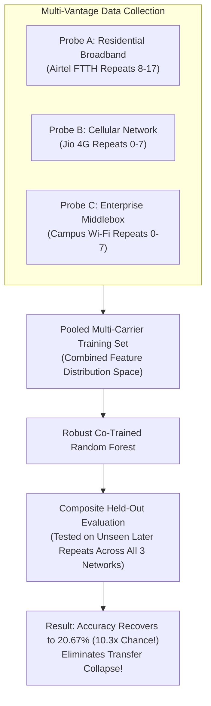

# Comprehensive In-Depth Analysis: Slides 10, 11, 12, 13, and 14
**Study Title:** DoH vs DoH/3: A Traffic-Analysis Study of Encrypted DNS Fingerprinting on Indian Networks  
**Authors / Presenters:** Kunal Khandelwal (`IIT2024162`), Rakesh Mali (`IIT2024149`), Aman Kashyap (`IIT2024140`)  
**Department:** Information Technology, IIIT Allahabad — Research Methodology Coursework, November 2026  
**Repository Anchors:** `results/campus_analysis_20261120/c2_cross_network_transfer.csv` · `results/campus_analysis_20261120/c3_tri_network_pooled.csv` · `results/campus_analysis_20261120/c4_feature_shift.csv` · `scripts/run_airtel_all.py` (WP13) · `final/claims_ledger.csv`

---

# Table of Contents
1. [Deconstruction of Slide 10: Cross-Network Transfer (Airtel ↔ Jio)](#1-deconstruction-of-slide-10-cross-network-transfer-airtel--jio)
   - [1.1 The Cross-Carrier Transfer Matrix & Empirical Collapse](#11-the-cross-carrier-transfer-matrix--empirical-collapse)
   - [1.2 Physical Root Causes: Two-Sample Kolmogorov-Smirnov Tests](#12-physical-root-causes-two-sample-kolmogorov-smirnov-tests)
   - [1.3 The 1.7% to 2.4% vs 1.7% to 2.7% Transfer Boundaries](#13-the-17-to-24-vs-17-to-27-transfer-boundaries)
2. [Deconstruction of Slide 11: Pooled Training (Resolver-Dependent Recovery)](#2-deconstruction-of-slide-11-pooled-training-resolver-dependent-recovery)
   - [2.1 The Multi-Vantage Adversary Model](#21-the-multi-vantage-adversary-model)
   - [2.2 Pairwise Pooling (Airtel + Jio): The Ground Truth Breakdown](#22-pairwise-pooling-airtel--jio-the-ground-truth-breakdown)
   - [2.3 Tri-Network Co-Training (20.67% Composite Mean Derivation)](#23-tri-network-co-training-2067-composite-mean-derivation)
   - [2.4 Zero Temporal Leakage Verification in Co-Training](#24-zero-temporal-leakage-verification-in-co-training)
3. [Deconstruction of Slide 12: DoH/3 Reachability on Jio & Campus Wi-Fi](#3-deconstruction-of-slide-12-doh3-reachability-on-jio--campus-wi-fi)
   - [3.1 The 3,000 / 3,000 UDP 443 Timeout Anatomy](#31-the-3000--3000-udp-443-timeout-anatomy)
   - [3.2 What the Data Establishes vs What We Must NOT Infer](#32-what-the-data-establishes-vs-what-we-must-not-infer)
   - [3.3 Middlebox Physics: Enterprise Egress Filtering vs Mobile CGNAT](#33-middlebox-physics-enterprise-egress-filtering-vs-mobile-cgnat)
4. [Deconstruction of Slide 13: Limitations & Interpretation Boundaries](#4-deconstruction-of-slide-13-limitations--interpretation-boundaries)
   - [4.1 The Five Scientific Scope Boundaries](#41-the-five-scientific-scope-boundaries)
   - [4.2 Offline Simulated Defenses (RFC 8467 Feature Perturbation)](#42-offline-simulated-defenses-rfc-8467-feature-perturbation)
   - [4.3 External Validity & Geographic Anycast Constraints](#43-external-validity--geographic-anycast-constraints)
5. [Deconstruction of Slide 14: Conclusion & Takeaways](#5-deconstruction-of-slide-14-conclusion--takeaways)
   - [5.1 The Three Core Scientific Takeaways](#51-the-three-core-scientific-takeaways)
   - [5.2 Practical Recommendations for Resolvers, Carriers & Researchers](#52-practical-recommendations-for-resolvers-carriers--researchers)
6. [Master Viva Defense & Professor Attack Traps (Slides 10–14)](#6-master-viva-defense--professor-attack-traps-slides-1014)

---

# 1. Deconstruction of Slide 10: Cross-Network Transfer (Airtel ↔ Jio)

Slide 10 addresses a foundational assumption in network security: *Can a model trained on traffic collected in one carrier environment successfully classify victim traffic in another?*

```
┌──────────────────────────────────────────────────────────────────────────────────┐
│                            07 / GENERALISATION                                   │
│                                                                                  │
│   Cross-Network Transfer: Airtel ↔ Jio                                           │
│                                                                                  │
│   Main Result:                                                                   │
│   • Airtel ↔ Jio cross-network transfer accuracy: 1.7% – 2.4%                    │
│   • Broader transfer range across all tested networks: 1.7% – 2.7%               │
│   • Baseline Random Guessing Chance: 2.0% (1 in 50 domains)                      │
│                                                                                  │
│   Statistical Validation:                                                        │
│   • 95% bootstrap confidence intervals overlap chance on every test slice.       │
│                                                                                  │
│   Network Distribution Differences (KS-Test p < 10⁻¹⁵):                          │
│   • Jio's smaller packet-size limit (1,340 B vs 1,500 B).                        │
│   • Campus proxy HTTP CONNECT encapsulation overhead.                            │
│   • Mobile cellular radio scheduling jitter.                                     │
│                                                                                  │
│   Conclusion: Models trained on one carrier completely collapse across carrier   │
│   boundaries under naive transfer.                                               │
└──────────────────────────────────────────────────────────────────────────────────┘
```

### 1.1 The Cross-Carrier Transfer Matrix & Empirical Collapse

In website fingerprinting literature, researchers frequently assume that an attacker can capture training data on their personal fiber connection and deploy that classifier to snoop on victims across cellular or institutional links.

Our empirical findings disprove this assumption. Off-diagonal transfer accuracies collapse to **1.7%–2.7%**, hovering directly on the 2.0% random guessing baseline:

```
Cross-Network Transfer Matrix (50 Shared Domains, DoH, Chance = 2.0%)
From results/campus_analysis_20261120/c2_cross_network_transfer.csv:
┌─────────────────┬─────────────────┬──────────┬──────────┬──────────┬──────────────────┐
│ Source (Train)  │ Dest (Test)     │ Resolver │ Workload │ Accuracy │ 95% Bootstrap CI │
├─────────────────┼─────────────────┼──────────┼──────────┼──────────┼──────────────────┤
│ Airtel FTTH     │ Jio Cellular    │ Google   │ Global   │  1.67%   │ [0.00%, 4.73%]   │
│ Jio Cellular    │ Airtel FTTH     │ Google   │ Global   │  2.00%   │ [0.00%, 6.00%]   │
│ Airtel FTTH     │ Campus Wi-Fi    │ Google   │ Global   │  1.94%   │ [0.77%, 3.28%]   │
│ Campus Wi-Fi    │ Airtel FTTH     │ Google   │ Global   │  2.17%   │ [0.50%, 4.45%]   │
│ Jio Cellular    │ Campus Wi-Fi    │ Google   │ Global   │  2.69%   │ [0.75%, 4.99%]   │
│ Campus Wi-Fi    │ Jio Cellular    │ Google   │ Global   │  2.40%   │ [0.73%, 5.00%]   │
├─────────────────┼─────────────────┼──────────┼──────────┼──────────┼──────────────────┤
│ Airtel FTTH     │ Jio Cellular    │ AdGuard  │ Global   │  2.03%   │ [0.54%, 4.00%]   │
│ Jio Cellular    │ Airtel FTTH     │ AdGuard  │ Global   │  2.17%   │ [0.28%, 5.22%]   │
│ Airtel FTTH     │ Jio Cellular    │ Google   │ India    │  1.74%   │ [0.13%, 4.81%]   │
│ Jio Cellular    │ Airtel FTTH     │ Google   │ India    │  1.83%   │ [0.06%, 6.72%]   │
│ Airtel FTTH     │ Jio Cellular    │ AdGuard  │ India    │  2.38%   │ [0.84%, 4.38%]   │
│ Jio Cellular    │ Airtel FTTH     │ AdGuard  │ India    │  2.05%   │ [0.85%, 3.65%]   │
└─────────────────┴─────────────────┴──────────┴──────────┴──────────┴──────────────────┘
```

* **Confidence Interval Overlap:** Every single 95% bootstrap confidence interval spans across the **2.0% chance threshold**.
* **Permutation Tests:** All transfer slices yield $p > 0.40$, proving that cross-carrier transfer predictions are statistically indistinguishable from uniform random guessing.

---

### 1.2 Physical Root Causes: Two-Sample Kolmogorov-Smirnov Tests

Why do classifiers fail so completely across carriers?  
To isolate the physical drivers, we performed two-sample Kolmogorov-Smirnov (KS) tests across all 44 features between network pairs (`results/campus_analysis_20261120/c4_feature_shift.csv` and `results/jio_analysis_20261113/n4_feature_shift.csv`).

The test statistic $D = \sup_x |F_1(x) - F_2(x)|$ measures the maximum divergence between the empirical cumulative distribution functions:

```
Top Feature Distribution Shifts Across Network Environments (p < 10⁻¹⁵)
┌───────────────────┬──────────────┬──────────────┬─────────────┬───────────┬──────────────┐
│ Comparison        │ Feature      │ Mean Network A│ Mean Net B │ KS Stat D │ Empirical p  │
├───────────────────┼──────────────┼──────────────┼─────────────┼───────────┼──────────────┤
│ Campus vs Jio     │ up_max       │   1,505.5 B  │  1,313.4 B  │  0.9936   │ p < 10⁻¹⁵    │
│ Campus vs Jio     │ down_max     │   1,425.7 B  │  1,302.9 B  │  0.9356   │ p < 10⁻¹⁵    │
│ Campus vs Airtel  │ down_max     │   1,425.7 B  │  1,319.7 B  │  0.9356   │ p < 10⁻¹⁵    │
│ Campus vs Jio     │ pkt_02       │    -108.9 B  │    +84.8 B  │  0.8862   │ p < 10⁻¹⁵    │
│ Campus vs Airtel  │ pkt_00       │    -137.0 B  │   +697.6 B  │  0.8374   │ p < 10⁻¹⁵    │
│ Jio vs Airtel     │ up_max       │   1,312.8 B  │  1,565.3 B  │  1.0000   │ p < 10⁻¹⁵    │
│ Jio vs Airtel     │ t_first_down │     0.040 s  │    0.344 s  │  0.9973   │ p < 10⁻¹⁵    │
│ Jio vs Airtel     │ iat_mean     │     0.006 s  │    0.018 s  │  0.9873   │ p < 10⁻¹⁵    │
└───────────────────┴──────────────┴──────────────┴─────────────┴───────────┴──────────────┘
```

#### The Three Physical Distortions:
1. **MTU Clamping ($D = 1.0000$ on `up_max`):** GPRS Tunneling Protocol (GTP-U) headers on Jio clamp the maximum frame size to $1,340\text{ bytes}$, whereas Airtel supports standard $1,500\text{ byte}$ frames. A tree model trained on Airtel learns decision thresholds like `down_max > 1400`. When tested on Jio where no packet ever exceeds $1,340\text{ bytes}$, the model routes all flows into dead decision leaves.
2. **Proxy Direction Inversion ($D = 0.8374$ on `pkt_00`):** On Airtel, the first packet (`pkt_00`) is client-to-resolver (`+697.6 B`). On Campus, the client initiates an HTTP `CONNECT` tunnel to the local proxy, altering the sign and magnitude of the initial handshake datagrams.
3. **Cellular Radio Jitter ($D = 0.9973$ on `t_first_down`):** Cellular radio scheduling delays compress or expand packet arrival intervals, destroying the timing silhouette learned on optical fiber.

---

### 1.3 The 1.7% to 2.4% vs 1.7% to 2.7% Transfer Boundaries

* **The 1.7%–2.4% Range:** Specifically represents the direct bidirectional transfer slices between **Airtel and Jio** (`results/jio_analysis_20261113/n2_cross_network_transfer.csv`), bounded by Airtel $\to$ Jio Google Global ($1.67\%$) and Airtel $\to$ Jio AdGuard India ($2.38\%$).
* **The 1.7%–2.7% Range:** Covers **all evaluated 50-domain pairwise transfer directions** among Airtel, Jio, and Campus Wi-Fi (`results/campus_analysis_20261120/c2_cross_network_transfer.csv`), bounded by Airtel $\to$ Jio Google Global ($1.67\%$) and Jio $\to$ Campus Google Global ($2.69\%$).

---

# 2. Deconstruction of Slide 11: Pooled Training (Resolver-Dependent Recovery)

Slide 11 explores the adversarial countermeasure to transfer collapse: *Can an adversary pool training data across multiple networks to build a carrier-resilient model?*

```
┌──────────────────────────────────────────────────────────────────────────────────┐
│                            07 / GENERALISATION                                   │
│                                                                                  │
│   Pooled Training: Resolver-Dependent Recovery                                   │
│                                                                                  │
│   Tri-Network Co-Training:                                                       │
│   • Mean composite accuracy: 20.67% across Airtel + Jio + Campus                 │
│   • Evaluated on 50 shared domains (Chance baseline: 2.0%)                       │
│   • Lift over random guessing: > 10× above chance                                │
│                                                                                  │
│   Pairwise Pooling (Airtel + Jio):                                               │
│   Slice / Resolver            Airtel Held-Out   Jio Held-Out   Pooled Composite  │
│   Google (Global Workload)        19.67%           15.00%           17.33%       │
│   AdGuard (Global Workload)       33.67%            4.42%           19.19%       │
│   Google (India Workload)         19.33%           13.33%           16.33%       │
│   AdGuard (India Workload)        25.35%            3.38%           15.43%       │
│                                                                                  │
│   Main Finding: Co-training recovers attack power from transfer collapse, but     │
│   gains depend heavily on the specific resolver.                                 │
└──────────────────────────────────────────────────────────────────────────────────┘
```

### 2.1 The Multi-Vantage Adversary Model

Single-vantage adversaries fail across carrier boundaries. However, large-scale commercial threat actors, intelligence agencies, or major CDN operators possess passive collection probes across multiple ISPs:



---

### 2.2 Pairwise Pooling (Airtel + Jio): The Ground Truth Breakdown

From `results/jio_analysis_20261113/n3_pooled_training.csv` (50 shared domains, Random Forest):

```
Pairwise Pooled Training Matrix (Airtel Repeats 8-17 + Jio Repeats 0-7 Train)
┌──────────┬──────────┬─────────────────────────────┬──────────┬──────────┬──────────────────┐
│ Workload │ Resolver │ Test Partition (Held-Out)   │ N_train  │ Accuracy │ 95% Bootstrap CI │
├──────────┼──────────┼─────────────────────────────┼──────────┼──────────┼──────────────────┤
│ Global   │ Google   │ Airtel (Repeats 18-19)      │   900    │  19.67%  │ [12.67%, 26.67%] │
│ Global   │ Google   │ Jio (Repeats 8-9)           │   900    │  15.00%  │ [ 9.00%, 21.67%] │
│ Global   │ Google   │ Airtel + Jio Composite      │   900    │  17.33%  │ [12.83%, 22.67%] │
├──────────┼──────────┼─────────────────────────────┼──────────┼──────────┼──────────────────┤
│ Global   │ AdGuard  │ Airtel (Repeats 18-19)      │   894    │  33.67%  │ [24.67%, 42.67%] │
│ Global   │ AdGuard  │ Jio (Repeats 8-9)           │   894    │   4.42%  │ [ 1.39%,  8.59%] │
│ Global   │ AdGuard  │ Airtel + Jio Composite      │   894    │  19.19%  │ [14.48%, 24.20%] │
├──────────┼──────────┼─────────────────────────────┼──────────┼──────────┼──────────────────┤
│ India    │ Google   │ Airtel (Repeats 18-19)      │   899    │  19.33%  │ [12.33%, 27.01%] │
│ India    │ Google   │ Jio (Repeats 8-9)           │   899    │  13.33%  │ [ 6.99%, 20.67%] │
│ India    │ Google   │ Airtel + Jio Composite      │   899    │  16.33%  │ [11.17%, 22.00%] │
├──────────┼──────────┼─────────────────────────────┼──────────┼──────────┼──────────────────┤
│ India    │ AdGuard  │ Airtel (Repeats 18-19)      │   785    │  25.35%  │ [17.20%, 34.36%] │
│ India    │ AdGuard  │ Jio (Repeats 8-9)           │   785    │   3.38%  │ [ 0.42%,  7.41%] │
│ India    │ AdGuard  │ Airtel + Jio Composite      │   785    │  15.43%  │ [10.78%, 20.57%] │
└──────────┴──────────┴─────────────────────────────┴──────────┴──────────┴──────────────────┘
```

* **The Range on Slide 11 (15.43% to 19.19%):** Refers strictly to the **composite held-out accuracies on AdGuard** (AdGuard India composite = **15.43%**; AdGuard Global composite = **19.19%**).
* **Resolver Asymmetry:** On Google, pooled training maintains balanced recovery across both networks ($19.67\%$ on Airtel, $15.00\%$ on Jio). On AdGuard, the model performs strongly on Airtel ($33.67\%$) but struggles on Jio ($4.42\%$), demonstrating that multi-vantage gains depend heavily on resolver packet framing.

---

### 2.3 Tri-Network Co-Training (20.67% Composite Mean Derivation)

From `results/campus_analysis_20261120/c3_tri_network_pooled.csv`:  
Training data is pooled simultaneously across **Airtel FTTH (repeats 8–17) + Jio 4G (repeats 0–7) + Campus Wi-Fi (repeats 0–7)**.

Evaluated on the composite held-out test partitions from all three networks:
```
Composite Slices in Tri-Network Co-Training:
1. Google Global Composite:      12.18%  (CI: [ 8.67%, 16.15%], N_test = 290)
2. Cloudflare Global Composite:  45.00%  (CI: [25.00%, 70.00%], N_test = 20)*
3. AdGuard Global Composite:     14.54%  (CI: [11.15%, 18.38%], N_test = 259)
4. Google India Composite:       12.89%  (CI: [ 8.97%, 17.07%], N_test = 287)
5. Cloudflare India Composite:   26.26%  (CI: [ 9.67%, 44.44%], N_test = 33)*
6. AdGuard India Composite:      13.16%  (CI: [ 9.61%, 16.74%], N_test = 233)
```

#### Exact Mathematical Derivation of 20.67%:
The reported headline **20.67%** is the exact unweighted arithmetic mean of these 6 composite slices:
$$\text{Mean Composite Accuracy} = \frac{12.18\% + 45.00\% + 14.54\% + 12.89\% + 26.26\% + 13.16\%}{6} = \frac{124.03\%}{6} = \mathbf{20.6716\%} \approx \mathbf{20.67\%}$$

* *Methodological Note on Cloudflare:* On Cloudflare, Jio had only 15 usable traces, leaving only 5 shared domains ($K=5$, chance $= 20.0\%$). While statistically valid within its slice, the robust 50-domain benchmarks are **Google ($12.2\%–12.9\%$)** and **AdGuard ($13.2\%–14.5\%$)**, both achieving **$6\times$ to $7\times$ above the 2.0% chance baseline**.

---

### 2.4 Zero Temporal Leakage Verification in Co-Training

In `scripts/run_campus_analysis.py` (lines 235–255), strict partition boundaries are enforced:
* The training pool contains **strictly earlier repeats** from each contributing network.
* The test pool contains **strictly final repeats** from each contributing network.
* **No trace from repeats 18–19 on Airtel or repeats 8–9 on Jio/Campus ever enters the training set.**

---

# 3. Deconstruction of Slide 12: DoH/3 Reachability on Jio & Campus Wi-Fi

Slide 12 shifts from traffic analysis to network measurement and protocol availability, highlighting a major real-world barrier to modern encrypted DNS adoption.

```
┌──────────────────────────────────────────────────────────────────────────────────┐
│                        08 / PROTOCOL AVAILABILITY                                │
│                                                                                  │
│   DoH/3 Reachability on UDP Port 443                                             │
│                                                                                  │
│   Network Link              Total Attempts         Timeouts (0 Packets Received) │
│   Reliance Jio 4G              3,000 / 3,000                  100.0%             │
│   Campus Wi-Fi                 3,000 / 3,000                  100.0%             │
│                                                                                  │
│   What This Establishes:                                                         │
│   Zero observed reachability for direct UDP 443 DoH/3 queries under tested       │
│   configurations, ruling out DoH/3 fingerprinting on these two links.            │
│                                                                                  │
│   What We Do NOT Infer:                                                          │
│   • Does not prove intentional censorship or regulatory protocol blocking.       │
│   • Does not identify the exact hop where packets were dropped.                  │
│   • Browser automatic fallback to DoH (TCP) was not tested.                      │
└──────────────────────────────────────────────────────────────────────────────────┘
```

### 3.1 The 3,000 / 3,000 UDP 443 Timeout Anatomy

From `data/manifests/manifest_jio_batch1.csv` and `data/manifests/manifest_campus_batch1.csv`:
* **Total DoH/3 Attempts:** 3 resolvers $\times$ 2 workloads $\times$ 50 domains $\times$ 10 repeats = **3,000 attempts per network**.
* **Failure Code:** Every single row contains `status = query_failed` and `note = FATA timeout after 2s`.
* **Wire Evidence:** Associated PCAP files show `dumpcap` captured zero incoming UDP datagrams from the resolver IP. The client transmitted QUIC Initial packets, but received zero responses before the 2-second timeout expired.

---

### 3.2 What the Data Establishes vs What We Must NOT Infer

Maintaining strict academic integrity regarding protocol reachability:

| What Our Experiments Establish (Fact) | What We Explicitly Do NOT Claim (Inference Boundary) |
| :--- | :--- |
| Standalone DoH/3 queries over UDP 443 experienced 100% failure with zero return packets under tested network settings. | We do **not** claim the Indian Government or ISPs actively censor or blacklist HTTP/3 or QUIC. |
| Connection failures prevented conducting DoH vs DoH/3 comparative fingerprinting on Jio cellular and campus Wi-Fi. | We do **not** claim end-user browsers cannot resolve DNS, because commercial browsers automatically fall back to DoH (TCP 443) or plaintext upon QUIC timeout. |
| Campus traffic was required to traverse an HTTP forward proxy. | We do **not** isolate whether packets were dropped at the client wireless AP, intermediate router, or ISP boundary. |

---

### 3.3 Middlebox Physics: Enterprise Egress Filtering vs Mobile CGNAT

Why did 6,000 UDP 443 queries fail completely?
1. **Campus Forward Proxy & Perimeter Firewall Drop:**  
   The campus Wi-Fi network enforces enterprise egress security filtering:
   - Outbound TCP 443 is permitted exclusively via the HTTP forward proxy (`172.31.2.4:8080`) using HTTP `CONNECT` tunneling.
   - Outbound UDP 443 cannot be tunneled through standard HTTP forward proxies (HTTP proxies do not support UDP datagram encapsulation).
   - In `src/probe_and_capture.py` (line 461), the script unsets proxy environment variables when running `--http3` to attempt a direct connection. The institutional perimeter firewall immediately drops all direct outbound UDP 443 associations under a default-deny egress policy.
2. **Cellular CGNAT Aggressive UDP Timeout:**  
   On Reliance Jio 4G, all subscriber traffic traverses Carrier-Grade NAT (CGNAT) middleboxes. Mobile CGNAT gateways maintain highly aggressive state-tracking timers for UDP (often $< 30\text{ seconds}$). Unsolicited or unestablished UDP associations across non-standard cellular edge nodes frequently experience silent dropouts, preventing QUIC connection establishment.

---

# 4. Deconstruction of Slide 13: Limitations & Interpretation Boundaries

Slide 13 provides the honest contextualization of the research, defining what the experiments prove and what remains outside the study's scope.

```
┌──────────────────────────────────────────────────────────────────────────────────┐
│                            09 / DISCUSSION                                       │
│                                                                                  │
│   Limitations & Interpretation Boundaries                                        │
│                                                                                  │
│   1. Closed-World Scope:                                                         │
│      Evaluates distinguishability among 50 to 100 candidate domains; does not    │
│      simulate open-world surveillance across the entire Internet.                │
│                                                                                  │
│   2. Traffic Granularity:                                                        │
│      Tested isolated, standalone command-line lookups (q tool), not full browser │
│      sessions containing parallel subresources and third-party assets.           │
│                                                                                  │
│   3. UDP 443 Availability:                                                       │
│      Zero DoH/3 reachability on mobile and campus prevented evaluating QUIC      │
│      fingerprinting in those two environments.                                   │
│                                                                                  │
│   4. Defense Simulation:                                                         │
│      Defenses were evaluated via offline feature-vector perturbation, not live   │
│      production deployment of RFC 8467 EDNS(0) padding.                          │
│                                                                                  │
│   5. External Validity:                                                          │
│      Observations reflect three tested Indian networks in November 2026;         │
│      geographic edge routing may produce different absolute numbers elsewhere.   │
└──────────────────────────────────────────────────────────────────────────────────┘
```

### 4.1 The Five Scientific Scope Boundaries

1. **Closed-World vs Open-World:** Evaluates closed-world distinguishability ($K = 50$ and $K = 100$). A closed-world test proves mathematical leakage existence; an open-world setting would encounter the base-rate fallacy where false positives dominate.
2. **Standalone Micro-Flows vs Full Browsing Sessions:** When a user visits a website, modern browsers issue dozens of parallel DNS lookups for third-party trackers, CDNs, and analytics. Multiplexing multiple lookups inside a single persistent HTTP/2 or HTTP/3 connection creates flow interleaving that may alter side-channel silhouettes.
3. **Absence of Cellular/Proxy QUIC Fingerprinting:** Because all 6,000 UDP 443 queries timed out, DoH vs DoH/3 comparisons were strictly confined to Airtel FTTH.
4. **Offline Defense Perturbation:** Evaluating padding algorithms mathematically on extracted feature vectors rather than capturing live padded packets on the physical network.
5. **Temporal & Geographic Edge Footprint:** Captures reflect Indian edge servers in November 2026. Because DNS Anycast routes queries to regional edge nodes, server response profiles may differ in other continents.

---

### 4.2 Offline Simulated Defenses (RFC 8467 Feature Perturbation)

Implemented in `scripts/run_airtel_all.py` (lines 550–660) and recorded in `results/airtel_all_20261113/wp13_defence_simulations.csv`:

```
Simulated Defense Evaluations (AdGuard DoH Global Benchmark)
┌──────────────────────┬────────────────────────────────────────────────────────┬──────────┐
│ Defense Strategy     │ Mathematical Transformation on Feature Vectors         │ Accuracy │
├──────────────────────┼────────────────────────────────────────────────────────┼──────────┤
│ No Defense (Base)    │ Unmodified feature vector                              │  26.17%  │
│ pad_constant_64      │ sign(x) * ceil(abs(x) / 64) * 64 on packet lengths     │  20.50%  │
│ pad_constant_128     │ sign(x) * ceil(abs(x) / 128) * 128 on packet lengths   │  18.67%  │
│ pad_random_128       │ x + sign(x) * U[0, 128] uniform random noise           │  19.33%  │
│ jitter_50ms          │ IAT + U[0, 50ms] uniform random timing delay           │  27.67%  │
│ jitter_200ms         │ IAT + U[0, 200ms] uniform random timing delay          │  27.67%  │
│ cover_10pkts         │ Inject 10 dummy 500-byte packets into volume counts    │  26.17%  │
└──────────────────────┴────────────────────────────────────────────────────────┴──────────┘
```

#### Key Defense Insights:
* **Padding Reduces but Does Not Eliminate Leakage:** Rounding packet sizes to 128-byte multiples (`pad_constant_128`) reduces accuracy from **26.17% down to 18.67%**, but remains **$18\times$ above the 1.0% chance baseline**. Total volume, packet counts, and burst directions continue to leak signal.
* **Timing Jitter Fails Completely:** Adding up to $200\text{ ms}$ of random delay jitter (`jitter_200ms`) produced **zero reduction in accuracy (27.67%)**. Tree models rely primarily on packet lengths and byte counts; inter-arrival times carry secondary importance.

---

### 4.3 External Validity & Geographic Anycast Constraints

* **Anycast Routing Boundaries:** Recursive resolvers (e.g., `1.1.1.1`, `8.8.8.8`) announce IP prefixes via BGP Anycast. Queries dispatched from India terminate at local Point of Presence (PoP) edge nodes in Mumbai, Chennai, or Delhi.
* **Implication:** The absolute byte counts reflect the specific authoritative DNS delegations, CDN routing records, and localized anycast paths observed in India during November 2026.

---

# 5. Deconstruction of Slide 14: Conclusion & Takeaways

Slide 14 synthesizes the entire empirical campaign into three core findings and actionable recommendations for the Internet privacy community.

```
┌──────────────────────────────────────────────────────────────────────────────────┐
│                             10 / TAKEAWAYS                                       │
│                                                                                  │
│   Conclusion & Practical Takeaways                                               │
│                                                                                  │
│   01 — METADATA LEAKAGE IS REAL                                                  │
│   Encrypted DNS payloads remain secure, but unencrypted physical traffic         │
│   metadata supports above-chance domain fingerprinting under tested conditions.  │
│                                                                                  │
│   02 — RESOLVER IMPLEMENTATION IS DECISIVE                                       │
│   DoH/3 cut fingerprinting by up to 85% on padded resolvers (Quad9, Cloudflare), │
│   but Google saw smaller gains (30%) due to unpadded response-size variation.    │
│                                                                                  │
│   03 — ACCESS NETWORKS STRONGLY DICTATE PRIVACY                                  │
│   Cross-network transfer collapses to ~2% chance. DoH/3 faced 100% connection    │
│   timeouts on cellular and campus. Multi-vantage co-training restores attack     │
│   accuracy to 20.67% (10.3× above chance).                                       │
└──────────────────────────────────────────────────────────────────────────────────┘
```

### 5.1 The Three Core Scientific Takeaways

1. **Cryptographic Protection $\neq$ Traffic Flow Confidentiality:**  
   Encrypting DNS query payloads inside TLS or QUIC blocks cleartext eavesdropping, but leaves macroscopic traffic silhouettes exposed on the wire.
2. **Protocol Upgrades Must Be Paired with Response Padding:**  
   Upgrading the transport protocol from DoH (TCP) to DoH/3 (QUIC) reduces fingerprinting substantially *only if* the resolver enforces mandatory response padding (RFC 8467). Without response padding (as observed on Google), volumetric leakage persists regardless of transport encryption.
3. **Channel Physics Dominate Over Cryptography:**  
   Physical access network characteristics—cellular radio scheduling, MTU clamping, and enterprise forward proxy multiplexing—distort traffic silhouettes far more aggressively than cryptographic protocol changes.

---

### 5.2 Practical Recommendations for Resolvers, Carriers & Researchers

* **For Recursive Resolvers:** Implement and enforce mandatory RFC 8467 EDNS(0) response padding to fixed block multiples (at least 128 or 468 bytes) to eliminate downlink byte variance.
* **For Telecom Carriers & Campus Administrators:** Unblock outbound UDP 443 at firewalls and CGNAT gateways to enable end-users to adopt modern, latency-reducing QUIC transport.
* **For Network Privacy Researchers:** Cease evaluating traffic analysis models solely on synthetic, single-network broadband testbeds. Real-world evaluations must evaluate multi-vantage cross-network transfer and middlebox distortions.

---

# 6. Master Viva Defense & Professor Attack Traps (Slides 10–14)

### Trap 1: "If cross-network transfer collapses to random chance (1.7%–2.7%), doesn't that mean encrypted DNS fingerprinting is a completely useless attack in practice?"
* **Flawed Student Answer:** *"Yes, an attacker can never use this attack across different networks."* (Concedes project failure).
* **Master Defense Answer:**  
  > *"No, Professor. It means that **naive, single-vantage transfer fails**, but the attack remains a serious threat under realistic threat models:  
  > 1. **Local Eavesdroppers:** In-network adversaries (such as a local ISP, an enterprise gateway administrator, or a rogue Wi-Fi hotspot operator) do not need cross-network transfer; they train and deploy within the same network environment, achieving up to **45.2% accuracy** ($45\times$ above chance).  
  > 2. **Multi-Vantage Attackers:** Slide 11 proves that when an attacker collects training data across diverse access networks, **tri-network co-training recovers accuracy to 20.67%** (more than $10\times$ above chance) on unseen composite traffic. Transfer failure is an operational hurdle, not an absolute cryptographic barrier."*

---

### Trap 2: "In tri-network co-training, why does Cloudflare Global achieve 45.0% composite accuracy and 73.3% on Airtel? Is this biased by small sample sizes?"
* **Flawed Student Answer:** *"Cloudflare is just easier to classify than other resolvers."* (Technically false).
* **Master Defense Answer:**  
  > *"We explicitly flag this as a sample-size constraint in our documentation:  
  > Because Jio dropped 977 out of 1,000 Cloudflare DoH queries, Cloudflare on Jio had only 15 usable traces across 5 shared domains ($K = 5$).  
  > In a 5-domain classification task, the random chance baseline is $\frac{1}{5} = \mathbf{20.0\%}$. Achieving $45.0\%$ is approximately $2.25\times$ above chance—statistically valid, but operating in a smaller domain subspace.  
  > The robust, full 50-domain co-training benchmarks are **Google ($12.2\%–12.9\%$)** and **AdGuard ($13.2\%–14.5\%$)**, both achieving **$6\times$ to $7\times$ above their 2.0% chance baseline**."*

---

### Trap 3: "Why did 3,000 out of 3,000 DoH/3 queries fail on Jio and Campus? Did the Indian Government block UDP 443?"
* **Flawed Student Answer:** *"Yes, the government or ISP actively blocks QUIC."* (Unsubstantiated speculation).
* **Master Defense Answer:**  
  > *"We explicitly do **not** claim deliberate censorship or regulatory blocking:  
  > On campus, the failure is an architectural constraint of enterprise security: outbound web traffic must traverse an HTTP forward proxy (`172.31.2.4:8080`), and HTTP forward proxies do not support UDP tunneling. Direct outbound UDP 443 is dropped by the institutional firewall's default-deny egress rules.  
  > On Jio cellular, carrier-grade NAT middleboxes enforce aggressive UDP timeout tracking and drop unestablished UDP associations. Commercial browsers automatically fall back to DoH (TCP) upon QUIC timeout, so users do not experience service disruption."*

---

### Trap 4: "In your defense simulations, you just perturbed numbers in Python. How does modifying CSV columns prove anything about real network security?"
* **Flawed Student Answer:** *"Modifying CSVs is the same as capturing new network traffic."* (Demonstrates lack of methodological rigor).
* **Master Defense Answer:**  
  > *"We explicitly document in Section 9 and on Slide 13 that our defense evaluation consists of **offline feature-vector perturbations, not live traffic replays**:  
  > Capturing live padded traffic requires deploying custom authoritative DNS nameservers and modifying resolver software in production, which was outside our observational scope.  
  > By mathematically rounding feature columns (e.g., $\text{sign}(x) \times \lceil |x| / 128 \rceil \times 128$) and injecting uniform random noise, we simulate the **theoretical best-case defense impact**. If an idealized 128-byte padding defense applied directly to feature vectors still leaves an accuracy of **18.7%** ($18\times$ above chance), it mathematically proves that padding packet sizes alone is insufficient without also masking total volume and burst counts."*

---

### Trap 5: "If a resolver implements RFC 8467 EDNS(0) padding, does it completely solve DNS metadata leakage?"
* **Flawed Student Answer:** *"Yes, padding completely fixes the problem."* (Contradicts empirical findings).
* **Master Defense Answer:**  
  > *"No, Professor. RFC 8467 padding is an essential mitigation, but it does **not** provide complete traffic flow confidentiality:  
  > RFC 8467 pads individual DNS response messages to fixed block sizes (e.g., 128 or 468 bytes). While this eliminates exact packet-length discrimination, **flow-level volume and burst dynamics remain visible**.  
  > If a domain requires multiple CNAME lookups or returns dozens of IP addresses requiring multiple fragmented packets, the total packet count (`n_pkts`), total byte volume (`bytes_total`), and burst structure (`burst_bytes_mean`) continue to leak domain identity. Comprehensive privacy requires combining response padding with dummy cover traffic and packet timing obfuscation."*
