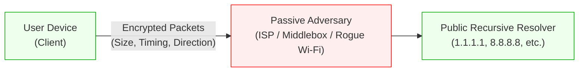

# Layer 1: Problem Definition & Threat Model

---

## 1. Plain-English Intuition: The "Enveloped Letter" Analogy

Imagine you are sending letters through the post office. 

* **Plaintext DNS (Do53)** is like sending a postcard. Anyone who touches the postcard—your local postman (the local Wi-Fi router), the transit sorting facility (your Internet Service Provider), or a government checkpoint—can read the front and back immediately: *"Alice is asking for the IP address of `medical-clinic.com`"*.
* **Encrypted DNS (DoH, DoQ, DoH/3)** was invented to solve this by putting the message into an opaque, tamper-evident envelope sealed with cryptographic locks (TLS 1.3 or QUIC). Now, the eavesdropper cannot read the text inside. They only see an envelope addressed to a major post office (e.g., Cloudflare at `1.1.1.1` or Google at `8.8.8.8`).

### The Flaw: Side-Channel Leakage
Even if you cannot read inside an envelope, you can still deduce what is inside:
1. **Weight & Thickness (Packet Length)**: A 1-page bank balance inquiry weighs differently than a 10-page legal contract. In DNS, asking for `google.com` (which has a short name and a couple of A records) creates a vastly different packet size than asking for `al-jazeera.com` (with multiple CNAMEs, IPv6 AAAA records, and DNSSEC signatures).
2. **Back-and-Forth Rhythm (Directional Timing)**: A multi-step conversation has a specific rhythm. How many packets does the client send before the server responds? When do acknowledgments occur?
3. **Cumulative Flow Footprint (Volume Dynamics)**: The total bytes exchanged during the initial TLS/QUIC handshake plus the DNS request and response forms a unique fingerprint.

**Core Research Premise**: Encrypting payload hides *contents*, but **metadata** (packet sizes, direction, timing) leaks the identity of the domain being queried. A passive network eavesdropper using machine learning can infer your private browsing targets with high statistical confidence.

---

## 2. Threat Model & Adversary Capabilities

### Who is the Adversary?
* **Physical Location**: On the local access link (e.g., coffee shop Wi-Fi administrator, university network gateway) or in the transit ISP (e.g., Airtel, Reliance Jio, or government monitoring middlebox).
* **Adversary Mode**: **Strictly Passive**.
  - The adversary **observes** packet headers (IP addresses, port numbers, TCP/UDP flags), frame lengths, packet arrival times, and flow directions.
  - The adversary **does NOT**:
    - Decrypt cryptographic keys (TLS/QUIC encryption remains unbroken).
    - Modify, inject, drop, or delay packets (no Man-In-The-Middle packet manipulation).
    - Compromise the client OS or the upstream recursive resolver.

### Evaluation Paradigm: Closed-World vs. Open-World
* **Experimental Formulation**: Closed-world classification over $K = 50$ popular domains (drawn from Tranco/umbrella lists representing news, streaming, tech, finance, and social media).
* **Random Guessing Baseline**:
  $$\text{Chance Baseline} = \frac{1}{K} = \frac{1}{50} = 2.0\%$$
* If a model scores **20.67%** or **45.2%**, it is **10× to 22× above chance**, proving massive statistical leakage.

---

## 3. Why Encrypted DNS Matters Even With HTTPS & ECH

A classic defense against website tracking has been HTTPS and Encrypted Client Hello (ECH / ESNI). A common misconception is: *"If HTTPS encrypts the URL, why does DNS matter?"*

1. **DNS is the Precursor to All Connections**: Before your browser can initiate an HTTPS connection to `example.com`, it *must* resolve `example.com` to an IP address. If the DNS query leaks, the adversary knows your destination before the HTTPS handshake even starts.
2. **Shared Hosting & CDNs Ruin IP Sniffing**: Many websites share the same Cloudflare or AWS CloudFront IP address (`104.16.x.x`). An ISP cannot determine which of 100,000 websites on that IP you visited—**unless** they observe your specific DNS query.
3. **The ECH Bootstrap Paradox**: ECH (Encrypted Client Hello) encrypts the Server Name Indication (SNI) in TLS 1.3. However, the client learns the server's public ECH key by fetching the **HTTPS DNS record (type 65)**. If the DNS query itself is unencrypted or fingerprinted, **ECH provides zero privacy advantage**.

---

## 4. Professor Viva Attack Scenarios

### Viva Trap 1: "Why did you waste time fingerprinting encrypted DNS when the ISP can simply read the SNI (Server Name Indication) in TLS?"
* **Flawed Student Answer**: *"Because encrypted DNS is the future and everyone will use it."* (Weak, doesn't address the network protocol stack).
* **Master Answer**:
  > *"That assumption holds only for legacy TLS. Modern browsers (Chrome, Firefox) and CDNs (Cloudflare) are aggressively deploying Encrypted Client Hello (RFC 8744 / Draft-ietf-tls-esni), which completely encrypts the SNI. In an ECH-enabled world, the TLS handshake reveals nothing about the destination domain beyond a shared CDN IP. 
  > 
  > Therefore, the DNS transaction becomes the **single remaining vector** for domain identification. However, as our research proves, simply wrapping DNS in TLS or QUIC without standardized packet padding and timing obfuscation leaves side-channel fingerprints that allow an ISP to recover the domain without breaking encryption."*

---

### Viva Trap 2: "If the connection uses AES-256-GCM or ChaCha20-Poly1305, how is it mathematically possible for an ML model to guess the domain?"
* **Flawed Student Answer**: *"The machine learning algorithm learns to decode the encrypted bytes."* (**Disastrous deduction**: ML cannot break symmetric ciphers).
* **Master Answer**:
  > *"The machine learning models never inspect or decrypt payload bytes. Modern stream ciphers preserve the exact plaintext length: if a DNS response plaintext is 243 bytes, adding an AEAD tag and record header makes it exactly 259 or 275 bytes.
  > 
  > Each unique domain has distinct zone configurations—differing query name lengths, number of authoritative name servers, CNAME alias chains, and DNSSEC RRSIG cryptographic signatures. These structural differences translate directly into distinct packet lengths and burst sequences. The ML models classify these **outer physical invariants**, which encryption protocols fail to conceal unless paired with constant-size padding."*

---

### Viva Trap 3: "Is closed-world (50 domains) realistic? An ISP sees millions of domains."
* **Flawed Student Answer**: *"Yes, 50 domains is enough for testing."* (Inaccurate).
* **Master Answer**:
  > *"The 50-domain closed-world model is the standard, foundational benchmark established in website fingerprinting literature (e.g., Wang et al., Panchenko et al., Siby et al.). Its purpose is not to deploy a production ISP surveillance tool tomorrow, but to scientifically establish **whether side-channel leakage exists** under rigorous laboratory conditions.
  > 
  > If a passive adversary can achieve 45.2% accuracy across 50 domains where random chance is 2.0% (a 22.6× advantage), the protocol unequivocally leaks information. In an open-world setting, this translates directly to high-precision selective surveillance (e.g., detecting visits to a specific sensitive blacklist of 50 targeted domains among unmonitored background traffic)."*

---

## 5. Key Takeaways Checklist (Remember for the Stage)

* [ ] **Threat Model**: Passive adversary observing packet lengths, timing, and direction on the access link (no MITM, no decryption).
* [ ] **Source of Leakage**: Domain structural metadata (CNAMEs, IPv6 records, DNSSEC signatures) creates unique packet length distributions that AES-GCM does not disguise without padding.
* [ ] **Baseline Math**: Closed-world 50 classes $\rightarrow$ Random chance baseline is $1/50 = 2.0\%$. Any result above 2% indicates measurable information leakage.
