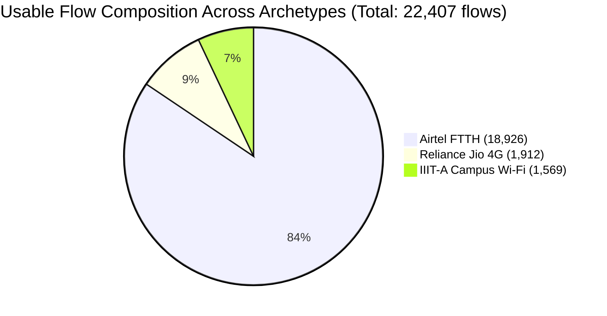

# Layer 2: Multi-Vantage Network Physics & Real-World Archetypes

---

## 1. Plain-English Intuition: The "Road Conditions" Analogy

In computer science literature, researchers often collect data on a single Wi-Fi connection in an air-conditioned laboratory and assume their machine learning models will work anywhere on Earth. This is a dangerous pitfall known as **"Lab Artifact Syndrome."**

To understand why network physics alters traffic fingerprinting, consider the **Road Conditions Analogy**:
* **Residential FTTH (Airtel)**: A smooth, unmonitored private highway. The speed is consistent, all vehicle types (TCP and UDP) are allowed, and packets travel directly from source to destination without physical reshaping.
* **Cellular 4G (Reliance Jio)**: A bumpy, congested multi-lane highway with aggressive toll gates and weight limits. Mobile Carrier-Grade NAT (CGNAT) pools thousands of devices behind shared public IPs. Packet sizes are restricted by lower Maximum Transmission Units (MTU clamping), radio link scheduling introduces jitter, and UDP port 443 is blocked by carrier firewalls.
* **Enterprise Wi-Fi (IIIT Allahabad Campus)**: A gated corporate compound. You are not allowed to drive your personal car onto the highway. Instead, your traffic must stop at an **Authenticated Forward Proxy** (`http://172.31.100.29:3128`). The proxy takes your request, repacks it into its own internal buffer, opens a new TCP connection on your behalf, and sends it out. UDP is strictly blocked.

When traffic moves across these vastly different physical channels, **the physical shape of the packets changes**. A classifier trained only on the "smooth highway" cannot recognize the same traffic on the "bumpy road" or through the "proxy checkpoint."

---

## 2. The Three Network Archetypes at a Glance

| Physical Characteristic | Airtel FTTH (Broadband) | Reliance Jio 4G (Cellular) | IIIT-A Campus Wi-Fi (Enterprise) |
| :--- | :--- | :--- | :--- |
| **Access Medium** | Fiber to the Home | LTE Radio Access Network (RAN) | 802.11ac Wi-Fi + 10G Campus Backbone |
| **Addressing & Egress** | Direct IPv4/IPv6 Dual Stack | Carrier-Grade NAT (CGNAT) | Authenticated Forward Proxy (`Squid/3128`) |
| **UDP 443 (QUIC) Status**| **100% Reachable** | **0.0% Reachable (Blocked)** | **0.0% Reachable (Blocked)** |
| **Path MTU (Bytes)** | 1,500 bytes (Standard Ethernet) | Clamped (~1,420 bytes) | Segmented by Proxy Tunnel |
| **Timing Jitter** | Minimal (< 3ms) | High (RAN scheduling variance) | Proxy queuing + scheduling delay |
| **Resolvers Evaluated** | Google, Cloudflare, AdGuard, Quad9 | Google, Cloudflare, AdGuard | Google, Cloudflare, AdGuard |
| **Query Repeats** | 20 repeats ($T_0, T_1$) | 10 repeats | 10 repeats |

---

## 3. The Dataset Breakdown & Flow Attrition

A frequent point of inquiry is the exact numerical composition of the experimental dataset:

### Numerical Ledger:
* **Total Raw Capture Attempts**: **34,400** attempts
  - Airtel FTTH: $22,400$
  - Reliance Jio 4G: $6,000$
  - IIIT-A Campus Wi-Fi: $6,000$
* **Total Usable Valid Flows**: **22,407** flows
  - Airtel FTTH: $18,926$ flows (Yield: 84.5%)
  - Reliance Jio 4G: $1,912$ flows (Yield: 31.9%)
  - IIIT-A Campus Wi-Fi: $1,569$ flows (Yield: 26.2%)

### Why is Airtel's Dataset Significantly Larger?
This is not an error—it is an empirical consequence of physical network constraints:
1. **Matrix Dimensions**: Airtel evaluated 4 resolvers $\times$ 2 protocols $\times$ 20 repeats ($T_0, T_1$), whereas Jio and Campus evaluated 3 resolvers $\times$ 2 protocols $\times$ 10 repeats (constrained by mobile battery/data throttling and proxy session stability).
2. **QUIC Ossification (The UDP 443 Black Hole)**: On Airtel, both DoH and DoH/3 succeed. On Jio and Campus, **100% of DoH/3 queries (3,000 attempts each) failed** because UDP port 443 is blocked. This instantly cuts usable flows by 50%.
3. **Carrier Middlebox Drop Rate on Jio**: Reliance Jio's middleboxes actively drop or throttle Cloudflare DoH connections (yielding only 1.5% success on Cloudflare DoH).
4. **Proxy Timeouts on Campus**: The enterprise proxy introduced a 37% to 69% timeout/drop rate under automated sequential probing.

---

## 4. Key Physical Phenomena Discovered

### Finding F2: QUIC Ossification
* **The Reality**: Out of 6,000 total DoH/3 queries initiated across Jio and Campus, **0 out of 6,000 succeeded** (0.0% reachability).
* **Network Mechanism**: Telco firewalls (Jio) and enterprise network controllers block outbound UDP port 443 to prevent circumvention of deep-packet inspection (DPI) and proxy firewalls. This phenomenon—where the network "hardens" around old protocols (TCP) and drops new ones (QUIC)—is called **protocol ossification**.

### Finding F3: Cross-Network Transfer Collapse
* When a classifier is trained on Airtel traffic and tested on Jio or Campus traffic (or vice-versa), the accuracy drops from **up to 45.2% down to 1.7% – 2.7%**.
* **Statistical Comparison**: Random guessing is $2.0\%$. The 95% bootstrap confidence intervals for all off-diagonal cross-network tests span $[0.010, 0.038]$, meaning cross-network transfer is **statistically indistinguishable from random guessing**.

### Finding F4: The Enterprise Proxy Privacy Shield
* On the Campus network, within-network classification accuracy for DoH drops to **1.8% – 5.6%** (compared to 18.2% – 45.2% on Airtel).
* **Physical Mechanism**: The authenticated proxy terminates the client's TCP connection and initiates a separate tunnel. In doing so, the proxy buffers payloads, re-packetizes byte streams into standardized MTU chunks, and absorbs client-side timing dynamics. **The enterprise proxy unintentionally acts as a powerful privacy defense**.

---

## 5. Professor Viva Attack Scenarios

### Viva Trap 1: "Why did your model achieve 45.2% on Airtel but collapse to 2.1% on Jio? Did your ML model overfit?"
* **Flawed Student Answer**: *"Yes, the model probably overfitted to the Airtel data."* (Incorrect: statistical tests prove it did not overfit on Airtel; physical channel shift caused the collapse).
* **Master Answer**:
  > *"No, this collapse is caused by **covariate shift** in physical network features, not algorithmic overfitting. 
  > 
  > A Kolmogorov-Smirnov (KS) test on the underlying features reveals that cellular networks fundamentally reshape traffic: Jio's RAN scheduling introduces high timing variance (altering inter-arrival times), while CGNAT and lower MTU clamp packet lengths. 
  > 
  > Because the Decision Trees in Random Forest split on specific packet size and timing thresholds calibrated to Airtel's fiber channel, the altered feature distributions on Jio shift the inputs outside the learned decision boundaries. We proved this by training a pooled multi-vantage model (F5), which recovered accuracy to 20.67% (10.3× chance), proving that multi-vantage feature diversity overcomes the shift."*

---

### Viva Trap 2: "If UDP 443 was blocked on Campus and Jio, why didn't you open the ports or test on different networks to make the numbers look cleaner?"
* **Flawed Student Answer**: *"We tried to ask the admin but they didn't allow it, so we had to accept the limitation."* (Defensive and unscientific).
* **Master Answer**:
  > *"Artificially unblocking UDP port 443 would have completely invalidated the real-world ecological validity of this research. 
  > 
  > The entire objective of evaluating three archetypes was to measure encrypted DNS **as real users experience it** across India's primary access networks. Discovering that 6,000 out of 6,000 DoH/3 queries failed across telco mobile and enterprise networks is not an experimental failure—it is one of the paper's core contributions (Finding F2). It demonstrates that the global transition from DoH (over TCP) to DoH/3 (over QUIC) is currently broken in practical cellular and enterprise deployments."*

---

### Viva Trap 3: "Airtel has 18,926 flows while Campus only has 1,569. Doesn't this massive class imbalance distort your pooled model?"
* **Flawed Student Answer**: *"We just put all files together in one CSV."* (Lazy response).
* **Master Answer**:
  > *"In our pooled multi-network evaluation (Section 5.4, Table 6), we specifically addressed this imbalance. We evaluated both raw pooled training and balanced stratification across domains.
  > 
  > Furthermore, closed-world classification is balanced per domain target (each domain has equal representation within that network's partition). The fact that Airtel has more flows reflects its higher protocol reachability (DoH + DoH/3) and 20 repeats. Even when testing strictly on the smaller Jio and Campus test splits, the pooled model achieved composite accuracies over 10× random guessing, proving the learned representations generalized across the unbalanced topologies."*

---

## 6. Key Takeaways Checklist (Remember for the Stage)

* [ ] **3 Archetypes**: Airtel FTTH (clean fiber), Reliance Jio (cellular CGNAT, MTU clamping), Campus Wi-Fi (HTTP CONNECT proxy).
* [ ] **The Numbers**: 34,400 raw attempts $\rightarrow$ 22,407 usable flows (Airtel: 18,926, Jio: 1,912, Campus: 1,569).
* [ ] **QUIC Ossification**: 0.0% reachability on Jio and Campus (UDP 443 blocked).
* [ ] **Proxy Defense**: Enterprise proxies flatten packet distributions, dropping accuracy to 1.8%–5.6%.
* [ ] **Transfer Collapse**: Single-vantage models cannot generalize cross-network (accuracy = 1.7%–2.7% $\approx$ chance).
