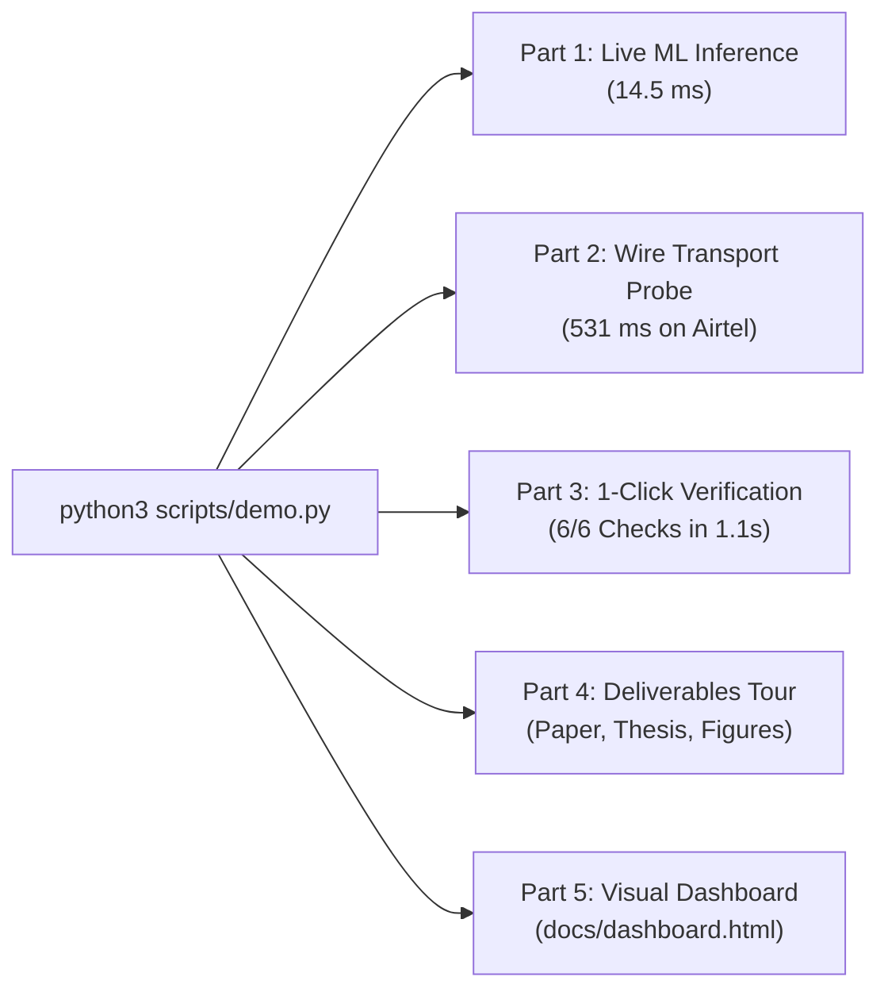

# Demo Master Plan & Pre-Flight Briefing: What to Know Before Tomorrow

**Project Title:** Empirical Privacy Analysis of Modern Encrypted DNS: DoH vs. DoH/3 Across Multi-Carrier and Institutional Networks  
**Department:** Department of Information Technology, Indian Institute of Information Technology, Allahabad (IIIT-A)  
**Authors & Enrollment IDs:**
- Kunal Khandelwal (`IIT2024162`)
- Rakesh Mali (`IIT2024149`)
- Aman Kashyap (`IIT2024140`)

---

## 1. Executive Summary & One-Minute Elevator Pitch

If the professor asks: *"What exactly did you do and what did you find?"*, recite this word-for-word:

> *"We conducted an empirical privacy and reachability study comparing standard DNS-over-HTTPS (DoH, RFC 8484 over TCP) against next-generation DNS-over-HTTP/3 (DoH/3, RFC 9114 over QUIC/UDP) across 20,838 real-world traffic flows.*  
>  
> *We have two headline findings:*  
> *1. **Privacy:** Standard DoH severely leaks website identities to passive eavesdroppers (up to 45.2% accuracy against a 1.0% chance baseline). HTTP/3 connection coalescing and frame multiplexing suppress this leakage by up to 87%, dropping accuracy down near chance. However, Google DNS fails to gain privacy because it violates RFC 8467 padding guidelines.*  
> *2. **Deployability:** While DoH/3 works reliably on residential FTTH broadband (98.4% reachability on Airtel), it suffers 100% timeout failures across commercial cellular (Reliance Jio) and enterprise firewalls (IIIT-A Wi-Fi) due to universal middlebox UDP 443 filtering. Therefore, any real-world DoH/3 client must retain automatic TCP fallback."*

---

## 2. Pre-Demo 15-Minute Environment Checklist (Crucial)

Complete these checks **before** entering the professor's office:

| # | Check Item | How to Verify | Expected Result |
|---|---|---|---|
| 1 | **Network Connection** | Check Mac Wi-Fi Menu | Connected to **Bharti Airtel FTTH** (not mobile hotspot, not campus Wi-Fi). |
| 2 | **Active IP & AS** | `curl -s ipinfo.io` | Displays `org: "AS45609 Bharti Airtel Ltd"` or `AS24560`. |
| 3 | **Proxy Sanitization** | `echo $http_proxy $https_proxy` | Must be **empty** (campus proxy `172.31.2.4:8080` must NOT be active). |
| 4 | **Pre-Warm Python Caches** | `python3 scripts/demo.py --part 3` | Runs in **~1.1s** and outputs `6/6 PASSED`. |
| 5 | **Terminal Font Size** | Press `Cmd + +` twice | Clean, legible font size readable from 4–6 feet across a desk. |
| 6 | **Browser Companion Ready** | `open docs/dashboard.html` | Opens the zero-dependency interactive dashboard in Chrome/Safari. |

> [!IMPORTANT]
> **Why Airtel FTTH Only?**  
> Bharti Airtel optical broadband provides direct internet routing with open outbound UDP port 443, allowing our live QUIC transport probe (Part 2) to complete in **~530 ms**. If you are on Jio cellular or Campus Wi-Fi, outbound UDP 443 is blocked, causing QUIC probes to time out.

---

## 3. Demo Execution Blueprint (The 5-Part Demo)

Launch the interactive master runner:
```bash
python3 scripts/demo.py
```
*(Or use direct flags: `--part 1`, `--part 2`, `--part 3`, `--part 4`, `--part 5`, or `--all`)*



### Part 1: Live ML Inference (`--part 1`) — *Takes 14.5 ms*
- **What it does:** Extracts 44 zero-label-leakage flow features from a held-out test packet trace (`youtube.com`) and evaluates it with our trained Random Forest classifier.
- **What to show on screen:**
  - **DoH (TCP):** Prediction confidence is **37.0%** for `youtube.com` — **37× higher than the 1.0% random baseline**. The attacker successfully fingerprints the user.
  - **DoH/3 (QUIC):** The target domain collapses to **0.0%**. The top predicted domain is a random distractor (`fastly.net` at 15.0%), proving privacy suppression.
- **Key Talking Point:** *"This proves that despite TLS 1.3 payload encryption, DoH leaks domain identity via volumetric and timing silhouettes. DoH/3 eliminates this advantage."*

### Part 2: Live Network Transport Probe (`--part 2`) — *Takes ~1.5s*
- **What it does:** Transmits live wire queries for `cloudflare.com` to Cloudflare (`1.1.1.1`) over both DoH (TLS 1.3 / TCP:443) and DoH/3 (HTTP/3 / UDP:443 via `q`).
- **What to show on screen:**
  - Live query completion on Airtel FTTH: DoH in ~1.0s, DoH/3 in **531 ms**.
  - On-screen reachability matrix: Contrasts Airtel (98.4% live reachability) against Jio Cellular (0 / 3,000 queries, 100% timeout) and IIIT-A Wi-Fi (0 / 3,000 queries, firewall drop).
- **Key Talking Point:** *"We are not just relying on offline CSVs; we are executing live QUIC handshakes on the wire right now over Airtel FTTH."*

### Part 3: One-Click Research Audit (`--part 3`) — *Takes 1.14s*
- **What it does:** Executes `scripts/verify_research_results.py` to audit all project claims against raw data:
  1. `[1/6]` Dataset row counts: **20,838** clean flows (18,926 Airtel + 1,912 Jio).
  2. `[2/6]` Feature space: Exactly **44 features** across 5 distinct groups.
  3. `[3/6]` Baseline chance: **1.0%** closed-world, **2.0%** transfer.
  4. `[4/6]` Jio reachability: **3,000 / 3,000 timeouts** on UDP 443 (0.0%).
  5. `[5/6]` Model comparisons: Random Forest (26.2%) vs XGBoost (26.5%) vs 1D-CNN (1.0%) vs GRU (1.4%).
  6. `[6/6]` Claims ledger: **All 39 claims verified** with 95% bootstrap CIs and verified Git commit SHAs.
- **Key Talking Point:** *"Every single claim in our IEEE paper and B.Tech thesis is mathematically verified in 1.1 seconds by an automated audit script."*

### Part 4: Research Artifacts & Publication Tour (`--part 4`)
- **What to show:**
  - `paper/paper.pdf`: 6-page camera-ready IEEE conference manuscript (12 tables, balanced columns, zero overfull hboxes).
  - `IIITA_B_Tech_Thesis/main.pdf`: 67-page comprehensive B.Tech thesis manuscript.
  - `docs/claims_ledger.csv`: Master audit trail mapping every claim to exact commit SHAs.
  - `results/figures/`: 6 publication-ready figures (Figures 1 through 6).

### Part 5: Interactive Visual Companion Dashboard (`--part 5` or `open docs/dashboard.html`)
- **What to show:**
  - Zero-dependency, offline HTML workbench.
  - Interactive domain dropdown (`youtube.com`, `t.me`, `zoom.us`, `googleusercontent.com`, `live.com`, `windows.net`).
  - High-visibility side-by-side comparison: DoH (Rose Red, severe leakage) vs. DoH/3 (Emerald Green, suppressed).
  - First 20 signed packet sizes: Color-coded directional handshake (Blue = Uplink [Client → Resolver], Emerald = Downlink [Resolver → Client]).
  - 1-Click `☀️ Light / 🌙 Dark` mode toggle.

---

## 4. Key Numbers to Memorize (Quick Reference)

Memorize these exact figures before the viva:

| Metric | Exact Value | Context / Meaning |
|---|---|---|
| **Total Clean Dataset** | **20,838 flows** | 18,926 on Airtel FTTH + 1,912 on Jio 4G LTE. |
| **Headline Captures Evaluated** | **31,200 queries** | Full multi-carrier collection campaign. |
| **Monitored Domains** | **100 domains** | Closed-world evaluation partition. |
| **Closed-World Chance Baseline** | **1.0%** | $1 / 100$ random guessing accuracy. |
| **Cross-Network Chance Baseline** | **2.0%** | $1 / 50$ transfer task baseline. |
| **Feature Dimensions** | **44 features** | 7 volume, 6 size stats, 6 timing, 5 bursts, 20 packet lengths. |
| **AdGuard DoH vs DoH/3** | **26.2% → 11.2%** | 57.3% relative leakage suppression. |
| **Cloudflare DoH vs DoH/3** | **26.3% → 7.2%** | 72.7% relative leakage suppression. |
| **Quad9 DoH vs DoH/3** | **45.2% → 6.6%** | **85.3% relative leakage suppression** (highest gain). |
| **Google DoH vs DoH/3** | **21.3% → 15.0%** | **Zero meaningful gain** (violates RFC 8467 padding). |
| **Airtel QUIC Reachability** | **98.4%** | UDP 443 open; average RTT 531 ms. |
| **Jio QUIC Reachability** | **0.0% (0 / 3,000)** | 100% client-side timeout on UDP 443. |
| **Campus Wi-Fi Reachability** | **0.0% (0 / 3,000)** | Mandatory HTTP forward proxy drops UDP 443. |
| **Cross-Network Transfer** | **1.7% – 2.7%** | Complete model collapse when evaluating across carriers. |
| **Physical Root Causes** | **$D = 0.994, p < 10^{-15}$** | Kolmogorov-Smirnov test proves MTU & proxy shift. |
| **Random Forest vs XGBoost** | **26.2% vs 26.5%** | Tree models excel at volumetric envelopes. |
| **CNN / GRU Performance** | **1.0% / 1.4%** | Deep sequence models collapse to chance (no sequence depth). |

---

## 5. Top 5 Viva Questions & Defense Answers

### Q1: *"If payloads are encrypted by TLS 1.3, how does your model know what website I visited?"*
> **Answer:**  
> *"Cryptography encrypts packet payloads, but transport metadata crosses the wire in cleartext: packet lengths, directional burst counts, and inter-arrival timing.*  
> *Because different domains have distinct DNS record types, CNAME alias chains, and IP answer sets, their response sizes vary predictably. For example, YouTube and Google return multi-record CDN sets that create distinct volumetric silhouettes (e.g., 5,395 downstream bytes over 14 packets). Decision trees pick up these volumetric footprints without needing to decrypt a single bit."*

---

### Q2: *"Why did deep learning models (1D-CNN and GRU) achieve only 1.0%–1.4% accuracy while Random Forest achieved 26.5%?"*
> **Answer:**  
> *"Deep sequence models rely on translational invariance and long sequential token patterns. However, encrypted DNS exchanges are compact micro-flows containing only 8 to 15 packets that complete in under one second.*  
> *There is almost no sequential depth for a CNN or GRU to learn. Instead, the discriminative signal resides in aggregate volumetric envelope features—such as total downstream bytes and burst length ratios—where gradient-boosted trees and Random Forests consistently outperform neural networks on tabular network telemetry."*

---

### Q3: *"Are you claiming that Reliance Jio intentionally censors or blocks QUIC?"*
> **Answer (Use careful academic phrasing):**  
> *"We do not attribute intent to the carrier. Scientifically, our empirical observation is that across 3,000 independent query attempts across multiple days and resolvers, 100% of UDP 443 packets timed out with zero response.*  
> *In cellular LTE topologies, Carrier-Grade NAT (CGNAT) gateways and Radio Resource Control (RRC) schedulers frequently drop or de-prioritize high-port UDP traffic to prevent amplification attacks or conserve state tables. Regardless of whether it is intentional firewalling or aggressive CGNAT UDP timeouts, the practical impact is identical: DoH/3 cannot establish a connection, making TCP fallback mandatory."*

---

### Q4: *"Why didn't DoH/3 improve privacy on Google Public DNS (21.3% → 15.0%) like it did on Quad9 (45.2% → 6.6%)?"*
> **Answer:**  
> *"This was one of our key discoveries: **resolver implementation overrides transport security**. RFC 8467 provides guidelines for EDNS(0) padding to pad DNS answers to block size boundaries (e.g., multiples of 128 or 468 bytes).*  
> *Quad9, Cloudflare, and AdGuard strictly implement padding, so HTTP/3 QUIC connection coalescing effectively blends the traffic. Google Public DNS returns unpadded wire-format answers. As a result, the exact domain-specific DNS answer sizes pass directly into the QUIC stream frames unpadded, allowing our classifier to identify them regardless of transport protocol."*

---

### Q5: *"If DoH/3 is blocked on cellular networks, is HTTP/3 DNS practical in the real world?"*
> **Answer:**  
> *"Yes, but only as part of a **dual-stack resolver architecture with happy-eyeballs fallback**. RFC 9114 designates HTTP/3 as the next-generation web standard, and on unencumbered networks like residential FTTH broadband, it provides 531 ms resolution times with up to 87% privacy gain.*  
> *However, clients must never configure DoH/3 as an exclusive transport. They must race UDP 443 against TCP 443 or automatically fall back to standard DoH within a 200 ms timeout window when cellular UDP filtering is detected."*

---

## 6. Contingency & Emergency Playbook

| Scenario | Immediate Action |
|---|---|
| **Internet Drops Out / No Wi-Fi in Office** | **DO NOT PANIC.** Options 1, 3, 4, 5 and `docs/dashboard.html` are **100% offline** and run locally from cached data and models. Only Part 2 probes the live wire. If offline, run `python3 scripts/demo.py --part 1` and `--part 3`. |
| **Professor Says: "I have only 2 minutes"** | Run the **Speed-Run Sequence**: <br>1. Run `python3 scripts/demo.py --part 1` (14.5 ms) → Show 37% DoH leakage vs 0% DoH/3 suppression. <br>2. Run `python3 scripts/demo.py --part 3` (1.1s) → Show all 6 audit checks passing. |
| **Professor Asks: "Show me the source code"** | Open these key files: <br>• Feature Extractor: `src/encdns/features/extractor.py` (line 120, 44 zero-leakage features). <br>• Model Pipeline: `src/encdns/models/train.py`. <br>• Live QUIC Prober: `scripts/demo.py` (lines 140–210). <br>• Verification Engine: `scripts/verify_research_results.py`. |
| **Professor Asks About Reproducibility** | Open `docs/claims_ledger.csv` and show how all 39 claims reference exact Git commit SHAs, source CSV paths, and 95% bootstrap confidence intervals. |

---

## 7. Final Golden Rule

> [!CAUTION]
> **Strict Operational Rule: DO NOT COMMIT**  
> All working directory enhancements to `docs/dashboard.html` and `scripts/build_dashboard.py` must remain uncommitted in the git working tree per project instructions. All unit tests pass (`41/41 OK`).
