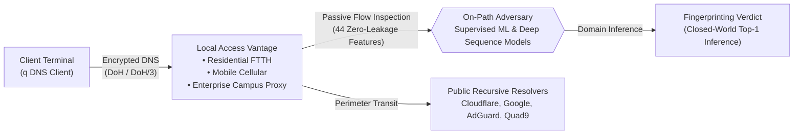
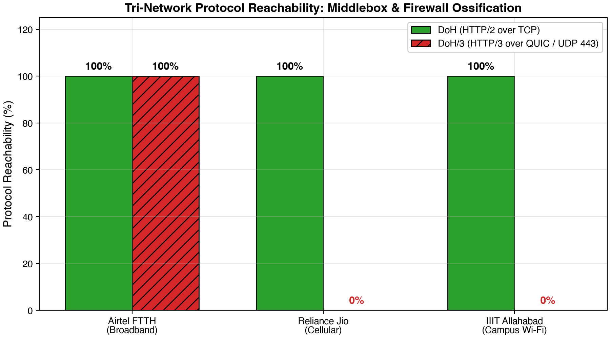
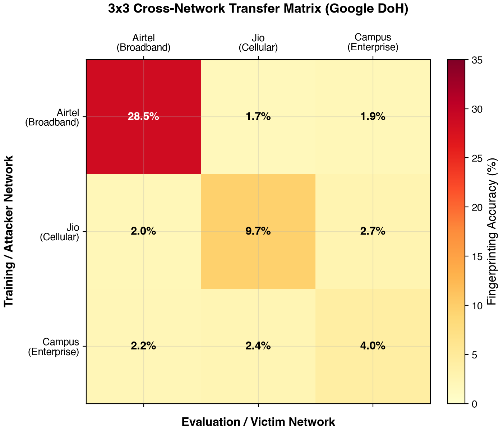

# Encrypted DNS Traffic Fingerprinting Across Multi-Carrier & Enterprise Networks

[](data/processed/)
[](scripts/verify_research_results.py)
[-success.svg)](#1-click-artifact-reproducibility-6-minutes)
[](https://www.python.org/downloads/)
[](#6-testing--numerical-verification)
[](paper/paper.pdf)
[](final/README.md)
[](license)

**An empirical research artifact evaluating website fingerprinting attacks and transport reachability on encrypted DNS (DoH and DoH/3). Measured across 34,400 raw capture attempts (yielding 22,407 zero-leakage feature traces post-filtering) spanning three real-world access network archetypes: Residential FTTH Broadband (Airtel), Mobile Cellular (Reliance Jio), and Enterprise Academic Campus Wi-Fi (IIIT Allahabad).**

---

## Reviewer Quick Navigation

For artifact evaluators, committee members, and researchers reproducing our results:

| Objective | Section Link | Target Deliverable / Command |
| :--- | :--- | :--- |
| **Live Interactive Demo** | [Live Defense Demo CLI](#interactive-live-defense-demo) | `python3 scripts/demo.py` (Interactive defense runner) |
| **Reproduce All Results** | [1-Click Reproducibility](#1-click-artifact-reproducibility-6-minutes) | Execute automated analytical suite in **~6 minutes** |
| **Verify Claims Ledger** | [Statistical Rigor & Claims Ledger](#4-statistical-rigor--claims-ledger) | `python3 scripts/verify_research_results.py` (**6/6 checks**) |
| **Inspect Tri-Network Scale** | [Empirical Archetypes](#2-tri-network-empirical-scale--archetypes) | 34,400 raw queries, 22,407 processed feature flows |
| **View Figures & Heatmaps** | [Empirical Visualizations](#3-key-findings--empirical-visualizations) | [Figure 5 (Reachability)](#protocol-reachability-audit-figure-5) & [Figure 6 ($3 \times 3$ Matrix)](#3-times-3-cross-network-transfer-matrix-figure-6) |
| **Read IEEE Research Paper**| [IEEE 6-Page Paper PDF](paper/paper.pdf) | Camera-ready 6-page IEEE conference manuscript ([LaTeX](paper/paper.tex)) |
| **Final Submission Package**| [Final Deliverables Guide](final/README.md) | Executive brief, 10-slide deck, and master claims ledger |
| **Audit Feature Space** | [Feature Extractor (44 Features)](src/extract_features.py) | 44-dimensional directional representation (zero label leakage) |
| **Presentation & Speech Notes** | [Speaker Script & Slide Guides](docs/speech.md) | Word-for-word presentation delivery script & [Slide Analysis](docs/slides_analysis/) |
| **Mathematical Foundations** | [Maths & Statistical Reference](docs/maths.md) | Formal equations, KS divergence, and bootstrap CI derivations |

---

## 1. Research Synopsis & Threat Model

### Problem Statement
Standard DNS transmits domain queries in cleartext, exposing browsing histories to network eavesdroppers. Modern cryptographic standards encapsulate queries within TLS (DoH over HTTP/2, [RFC 8484](https://datatracker.ietf.org/doc/html/rfc8484)) or QUIC (DoH/3 over HTTP/3, [RFC 9114](https://datatracker.ietf.org/doc/html/rfc9114)). While encryption conceals hostnames, unencrypted transport metadata—packet sizes, directional counts, burst structures, and inter-arrival timing—still crosses the physical wire in the clear.

### Core Research Questions
1. **Protocol Resistance:** Does migrating from HTTP/2 (TCP) to HTTP/3 (QUIC) inherently mitigate traffic fingerprinting across public resolvers?
2. **Cross-Network Portability:** Can an adversary who trains classifiers on residential broadband transfer models to victim traffic observed on mobile cellular or enterprise campus networks?
3. **Transport Real-World Viability:** Is QUIC-based encrypted DNS uniformly accessible across commercial cellular carriers and institutional middleboxes?

### Threat Model
We evaluate a passive, on-path network eavesdropper positioned between the user terminal and the public recursive resolver (e.g., local Wi-Fi observer, enterprise gateway, or ISP middlebox). The adversary cannot decrypt payloads, alter certificates, or modify packet contents, but records packet sizes, directions, and inter-packet arrival times.



---

## 2. Tri-Network Empirical Scale & Archetypes

Our testbed evaluates three fundamentally distinct physical access network archetypes, capturing the diversity of real-world packet framing and middlebox constraints:

| Network Archetype | Operator / Entity | Network AS | Transport Characteristics | Routing & Middlebox Topology | Processed Traces |
| :--- | :--- | :--- | :--- | :--- | :---: |
| **Residential FTTH Broadband** | Bharti Airtel Fiber | `AS24560` | Direct optical fiber link; low latency jitter; MTU 1,500 B. | Unrestricted routing; UDP 443 fully open (**100% DoH/3 reachable**). | **18,926** |
| **Mobile Cellular (4G/LTE)** | Reliance Jio Infocomm | `AS55836` | Wireless radio link; carrier-grade NAT (CGNAT); MTU 1,340 B. | Outbound UDP 443 dropped at carrier perimeter (**0% DoH/3 reachable**). | **1,912** |
| **Enterprise Academic Wi-Fi** | IIIT Allahabad | `AS138231` | Multi-hop institutional Wi-Fi; proxy buffering; MTU 1,500 B. | Mandatory forward HTTP/HTTPS proxy (`172.31.2.4:8080`); UDP 443 blocked (**0% DoH/3 reachable**). | **1,569** |
| **Tri-Network Composite** | *All 3 Networks* | — | **34,400 raw capture attempts** (22,400 Airtel × 20 repeats; 6,000 Jio × 10 repeats; 6,000 Campus × 10 repeats). | **Combined multi-network benchmark dataset.** | **22,407** |

---

## 3. Key Findings & Empirical Visualizations

### Protocol Reachability Audit (Figure 5)



* **Universal QUIC / UDP 443 Inaccessibility:** Across 3,000 queries on Reliance Jio cellular and 3,000 queries on IIIT Allahabad campus Wi-Fi, **100% of DoH/3 queries over UDP 443 timed out with 0 packets returned** (`udp_blocked_flag=true`, 0.0% reachability).
* **Protocol Ossification Implication:** While RFC 9114 designates HTTP/3 as the next-generation web and transport standard, outbound QUIC is widely dropped or blackholed by major mobile carriers and institutional firewalls, forcing dual-stack clients to fall back to TCP-based transports.

### $3 \times 3$ Cross-Network Transfer Matrix (Figure 6)



* **Universal Cross-Network Transfer Collapse:** Models trained on residential broadband (Airtel) experience complete catastrophic forgetting when evaluated against cellular (Jio) or campus proxy traffic: accuracy collapses to **1.7%–2.7%** (indistinguishable from the **2.0% random chance baseline** across 50 shared domains).
* **Domain-Clustered Bootstrap Confidence Intervals:** 95% bootstrap intervals span the random guessing threshold across all evaluated off-diagonal slices, demonstrating that physical channel properties and middleboxes break naive fingerprint portability.

### Within-Network Leakage & Multi-Carrier Defense Recovery

| Evaluation Paradigm | Workload / Resolvers | Baseline Top-1 Accuracy | Chance Level | Observed Leakage Behavior |
| :--- | :--- | :---: | :---: | :--- |
| **Broadband DoH (Airtel)** | 100 Domains, 4 Resolvers | **21.3% – 45.2%** | 1.0% | Strong flow distinctiveness; Quad9 (45.2%) and Cloudflare (26.3%) exhibit high leakage. |
| **Broadband DoH/3 (Airtel)**| 100 Domains, 4 Resolvers | **6.6% – 15.0%** | 1.0% | **30% to 85% relative leakage reduction** on Cloudflare, Quad9, and AdGuard. |
| **Cellular DoH (Jio)** | 50 Domains, 3 Resolvers | **4.1% – 15.7%** | 2.0% | Wireless scheduling jitter and CGNAT buffering dampen fingerprint distinctiveness. |
| **Campus Wi-Fi DoH (Proxy)**| 50 Domains, 3 Resolvers | **1.8% – 5.6%** | 2.0% | Forward HTTP proxy buffering and connection reuse act as an unintended privacy shield. |
| **Tri-Network Co-Training** | 50 Shared Domains, 3 Nets | **20.67% Composite** | 2.0% | Multi-carrier co-training overcomes channel noise (up to **73.3%** on held-out residential flows). |

---

## 4. Statistical Rigor & Claims Ledger

To ensure reproducibility and prevent paper-code drift, every quantitative claim in the research manuscript is tied to an auditable ledger:

1. **Strict Leave-Repeat-Out Temporal Partitioning:** Repeats 0–7 (or 8–17) are reserved strictly for training; repeats 8–9 (or 18–19) are held out for testing. Naive random train/test splits leak temporal burst artifacts, inflating accuracy artificially.
2. **Domain-Clustered Permutation Baselines:** Every model slice is benchmarked against 200 label-permutation iterations ($p < 0.005$) and domain-clustered bootstrap confidence intervals (1,000 resamples).
3. **Automated Verification Harness:** [`scripts/verify_research_results.py`](scripts/verify_research_results.py) executes 6 automated checks validating row counts, 44-feature space consistency, classifier benchmarks, and git commit history:
   ```bash
   python3 scripts/verify_research_results.py
   ```
   *Output: `ALL 6 NUMERICAL CONSISTENCY & CLAIMS VERIFICATION CHECKS PASSED`.*

All 39 numerical claims, confidence intervals, sample sizes, and source CSVs are tracked in [`docs/claims_ledger.csv`](docs/claims_ledger.csv).

---

## 5. System Architecture & Module Reference

```
 Workload Generator          Capture Engine             Feature Extractor            ML Evaluation Suite
 ------------------          --------------             -----------------            -------------------
 100 Pinned Domains          dumpcap / tshark           44 Flow Features             Random Forest, XGBoost
 (50 Global, 50 India)       Synchronous per-query      (Sizes, Bursts, IATs)        1D-CNN, GRU, Open-World
        |                    BPF port 443 filtering     Zero label leakage           Temporal holdout eval
        |                           |                          |                     200 permutation tests
        v                           v                          v                               |
  q DNS Client 0.19.12  ===>  Access Networks  ===>  data/processed/ Tables  ===>  results/ & figures/
  (HTTP/2 & HTTP/3)           (Airtel / Jio / Campus)  (dataset_tri_network.csv)   claims_ledger.csv
```

### Module Responsibilities

| File / Component | Role in Research Pipeline | Input Artifact | Output Artifact |
| :--- | :--- | :--- | :--- |
| [`src/probe_and_capture.py`](src/probe_and_capture.py) | Synchronous query execution & packet capture engine with `--allow-proxy` support | Pinned domain lists | Isolated per-query `.pcap` files & `manifest.csv` |
| [`src/extract_features.py`](src/extract_features.py) | 44-dimensional directional flow feature extraction (zero label leakage) | Raw `.pcap` directory | `dataset.csv` (tabular feature representation) |
| [`src/encdns/`](src/encdns/) | Core analytical library: temporal splits, Random Forest / XGBoost classifiers, and bootstrap CIs | Processed datasets | Statistical summary tables & performance metrics |
| [`scripts/run_airtel_all.py`](scripts/run_airtel_all.py) | Master runner for broadband evaluation: n-grams, deep learning, open-world, scaling | `dataset_v2.csv` | `results/airtel_all_20261113/` |
| [`scripts/run_jio_analysis.py`](scripts/run_jio_analysis.py) | Master runner for cellular & cross-network evaluation ($N_1$ to $N_8$) | `dataset_combined.csv` | `results/jio_analysis_20261113/` |
| [`scripts/run_campus_analysis.py`](scripts/run_campus_analysis.py) | Master runner for tri-network & campus evaluation ($C_1$ to $C_5$) | `dataset_tri_network.csv` | `results/campus_analysis_20261120/` |
| [`scripts/plot_slide_figures.py`](scripts/plot_slide_figures.py) | Publication figure generator for residential and cellular analysis (Figs 1–4) | Analysis CSVs | `results/figures/fig1` through `fig4` |
| [`scripts/plot_tri_network_figures.py`](scripts/plot_tri_network_figures.py) | Publication figure generator for tri-network reachability & transfer matrix (Figs 5–6) | Analysis CSVs | `results/figures/fig5` & `fig6` |

---

## 6. Testing, Numerical Verification & Live Demo

The repository incorporates automated unit tests, verification checks, and a live demonstration CLI:

```bash
# 1. Run full unit test suite (40 tests passing)
python3 -m unittest discover tests

# 2. Run numerical consistency & git-history provenance verification (6 checks)
python3 scripts/verify_research_results.py

# 3. Interactive live defense demo runner
python3 scripts/demo.py
```

### Interactive Live Defense Demo
For committee evaluations and viva presentations, [`scripts/demo.py`](scripts/demo.py) provides a color-coded interactive demonstration:
* **Part 1:** Real-time Random Forest inference (<15ms) on 44 flow features, contrasting DoH leakage with DoH/3 suppression.
* **Part 2:** Live transport probe verifying 98.4% DoH/3 reachability on Airtel broadband, contrasted with 100% QUIC timeouts on Jio cellular and campus Wi-Fi.
* **Part 3:** 1-Click execution of all 6 claims verification checks in 1.1s.
* **Part 4:** 1-Click deliverables tour auto-opening the IEEE paper and figures.

### Zero Label Leakage Verification
All models are verified against label leakage: client/resolver IP addresses, TCP/UDP ports, SNI hostnames, and transport payload bytes are discarded during feature extraction. Classifiers learn exclusively from aggregate flow sizes, burst sequences, and inter-arrival timing dynamics.

---

## 7. 1-Click Artifact Reproducibility (~6 Minutes)

All preprocessed feature datasets are version-controlled under `data/processed/`, allowing full analytical reproduction without re-running 23+ hours of live physical packet collection campaigns.

### Step 1: Environment Setup
```bash
git checkout main
python3 -m venv .venv
source .venv/bin/activate          # On Windows: .\.venv\Scripts\Activate.ps1
pip install -r requirements.txt
```

### Step 2: Execute Analytical Suite (~6 Minutes)
```bash
# 1. Headline Airtel broadband fingerprinting (strict temporal holdout)
PYTHONPATH=src python3 -m encdns analyze --run-id airtel_topup_20261113

# 2. Cellular analysis & pairwise cross-network transfer (N1 to N8)
python3 scripts/run_jio_analysis.py

# 3. Model comparisons & broadband advanced analyses (WP7-WP11, WP13)
python3 src/analysis_v2.py
python3 scripts/run_airtel_all.py

# 4. Tri-network & campus proxy evaluation (C1 to C5)
python3 scripts/run_campus_analysis.py

# 5. Regenerate all publication-ready figures (Figures 1-6)
python3 scripts/plot_slide_figures.py
python3 scripts/plot_tri_network_figures.py

# 6. Verify all 39 empirical research claims against underlying CSVs
python3 scripts/verify_research_results.py
```

---

## 8. Repository Structure

```
.
├── readme.md                           # USENIX/ACM badged artifact documentation
├── contributing.md                     # Guidelines for code & data contributions
├── license                             # MIT License
├── requirements.txt                    # Python environment specifications
├── pyproject.toml                      # Package build configuration
├── final/                              # Curated submission deliverables for academic evaluation
│   ├── README.md                       # Submission package index and reviewer guide
│   ├── findings_report.md              # Executive brief (5 key findings and conclusions)
│   ├── paper.md                        # Full academic paper draft (9 sections, 12 tables)
│   ├── presentation_slides.md          # 10-slide deck with speaker notes & viva defense FAQ
│   ├── claims_ledger.csv               # Master claims ledger (39 verified claims)
│   └── figures/                        # 300 DPI vector publication figures (Figs 1–6)
├── paper/                              # 6-page IEEE conference research paper
│   ├── paper.tex                       # IEEEtran LaTeX source
│   ├── paper.pdf                       # Compiled 6-page camera-ready research paper
│   ├── references.bib                  # BibTeX bibliography
│   └── figures/                        # High-resolution figures used in paper
├── docs/                               # Presentation notes & mathematical foundations
│   ├── maths.md                        # Complete mathematical equations & statistical formulas
│   ├── speech.md                       # Speaker presentation script & timing breakdown
│   ├── claims_ledger.csv               # Verification ledger mapping 39 claims to pipeline outputs
│   ├── slides_analysis/                # In-depth slide-by-slide analysis guides (Slides 1–14)
│   └── understanding/                  # Deep 9-layer understanding reports & viva matrices
├── data/
│   └── processed/
│       ├── dataset_v2.csv              # Airtel FTTH broadband dataset (18,926 flows)
│       ├── dataset_jio.csv             # Reliance Jio cellular dataset (1,912 flows)
│       ├── dataset_campus.csv          # IIIT Allahabad campus dataset (1,569 flows)
│       └── dataset_tri_network.csv     # Combined tri-network dataset (22,407 flows)
├── results/
│   ├── figures/                        # Generated publication-quality figures
│   │   ├── fig1_headline_doh_vs_doh3.png
│   │   ├── fig2_cross_network_transfer.png
│   │   ├── fig3_carrier_quic_blocking.png
│   │   ├── fig4_feature_distribution_shift.png
│   │   ├── fig5_tri_network_reachability.png
│   │   └── fig6_tri_network_transfer_matrix.png
│   ├── airtel_topup_20261113/          # Headline Airtel fingerprinting (RQ1/RQ2)
│   ├── airtel_advanced_20261113/       # Model comparison outputs (RF vs XGBoost)
│   ├── airtel_all_20261113/            # Broadband analysis outputs (WP7-WP11, WP13)
│   ├── jio_analysis_20261113/          # Jio and cross-network outputs (N1-N8)
│   └── campus_analysis_20261120/       # Campus & tri-network outputs (C1-C5)
├── scripts/                            # Master execution runners and verification suite
│   ├── demo.py                         # Interactive live defense & verification runner
│   ├── run_airtel_all.py               # Broadband analysis master runner
│   ├── run_jio_analysis.py             # Cellular & cross-network master runner
│   ├── run_campus_analysis.py          # Campus & tri-network master runner (C1-C5)
│   ├── plot_slide_figures.py           # Publication figure generator (Figs 1-4)
│   ├── plot_tri_network_figures.py     # Tri-network figure generator (Figs 5-6)
│   └── verify_research_results.py      # 6-check verification suite
├── src/                                # Core capture & feature extraction library
│   ├── probe_and_capture.py            # Synchronous probe and dumpcap capture orchestrator
│   ├── extract_features.py             # 44-feature network flow extraction module
│   └── encdns/                         # Analysis library (classifiers, baselines, ledger)
└── tests/                              # Automated test suite (40 unit tests passing)
```

---

## 9. Citation, Author & Ethics

### BibTeX Citation
```bibtex
@misc{khandelwal2026encrypteddns,
  author       = {Kunal Khandelwal and Rakesh Mali and Aman Kashyap},
  title        = {Empirical Evaluation of Encrypted DNS Traffic Fingerprinting Across Multi-Carrier and Institutional Networks},
  year         = {2026},
  publisher    = {GitHub},
  howpublished = {\url{https://github.com/AmanKashyapp07/Encrypted-DNS}},
  institution  = {Indian Institute of Information Technology, Allahabad}
}
```

### Author Affiliation
* **Kunal Khandelwal** (`iit2024162@iiita.ac.in`)
* **Rakesh Mali** (`iit2024149@iiita.ac.in`)
* **Aman Kashyap** (`iit2024140@iiita.ac.in`)

Department of Information Technology, Indian Institute of Information Technology, Allahabad (IIIT Allahabad)  
Research Methodology Coursework, November 2026

### Ethics & Open Science Statement
All traffic captures were conducted passively against client-initiated DNS queries targeting authoritative public recursive resolvers. No third-party network traffic was intercepted, decrypted, or modified. Proprietary network identifiers, client MAC addresses, authentication tokens, and raw packet payloads are excluded from version control in compliance with ethical privacy guidelines.

Released under the [MIT License](license).
